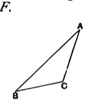

therefore the remaining angle at $A$ is equal to the remaining angle at $G$. [I. 32]

Therefore the triangle $ABC$ is equiangular with the triangle $GEF$.

Therefore in the triangles $ABC, GEF$ the sides about the equal angles are proportional, and those are corresponding sides which subtend the equal angles; [VI. 4]
$$\text{therefore, as } AB \text{ is to } BC\text{, so is } GE \text{ to } EF\text{.}$$
But, as $AB$ is to $BC$, so by hypothesis is $DE$ to $EF$;
$$\text{therefore, as } DE \text{ is to } EF\text{, so is } GE \text{ to } EF\text{.} \tag{V. 11}$$
Therefore each of the straight lines $DE, GE$ has the same ratio to $EF$;
$$\text{therefore } DE \text{ is equal to } GE\text{.} \tag{V. 9}$$
For the same reason
$$DF \text{ is also equal to } GF\text{.}$$
Since then $DE$ is equal to $EG$,
and $EF$ is common,
the two sides $DE, EF$ are equal to the two sides $GE, EF$;
and the base $DF$ is equal to the base $FG$;
therefore the angle $DEF$ is equal to the angle $GEF$, [I. 8]
and the triangle $DEF$ is equal to the triangle $GEF$,
and the remaining angles are equal to the remaining angles, namely those which the equal sides subtend. [I. 4]
Therefore the angle $DFE$ is also equal to the angle $GFE$,
and the angle $EDF$ to the angle $EGF$.
And, since the angle $FED$ is equal to the angle $GEF$, while the angle $GEF$ is equal to the angle $ABC$, therefore the angle $ABC$ is also equal to the angle $DEF$.
