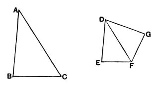

Therefore the triangle $ABC$ is equiangular with the triangle $DGF$.

Therefore, proportionally, as $BA$ is to $AC$, so is $GD$ to $DF$. [VI. 4]

But, by hypothesis, as $BA$ is to $AC$, so also is $ED$ to $DF$;
therefore also, as $ED$ is to $DF$, so is $GD$ to $DF$. [V. 11]

Therefore $ED$ is equal to $DG$; [V. 9]
and $DF$ is common;
therefore the two sides $ED, DF$ are equal to the two sides $GD, DF$; and the angle $EDF$ is equal to the angle $GDF$;
therefore the base $EF$ is equal to the base $GF$,
and the triangle $DEF$ is equal to the triangle $DGF$,
and the remaining angles will be equal to the remaining angles, namely those which the equal sides subtend. [I. 4]
Therefore the angle $DFG$ is equal to the angle $DFE$,
and the angle $DGF$ to the angle $DEF$.
But the angle $DFG$ is equal to the angle $ACB$;
therefore the angle $ACB$ is also equal to the angle $DFE$.
And, by hypothesis, the angle $BAC$ is also equal to the angle $EDF$;
therefore the remaining angle at $B$ is also equal to the remaining angle at $E$; [I. 32]
therefore the triangle $ABC$ is equiangular with the triangle $DEF$.

Therefore etc.

$$\text{Q. E. D.}$$
