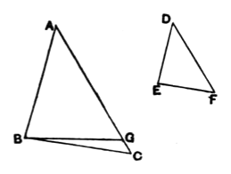

### PROPOSITION 7.

*If two triangles have one angle equal to one angle, the sides about other angles proportional, and the remaining angles either both less or both not less than a right angle, the triangles will be equiangular and will have those angles equal, the sides about which are proportional.*

Let $ABC, DEF$ be two triangles having one angle equal to one angle, the angle $BAC$ to the angle $EDF$, the sides about other angles $ABC, DEF$ proportional, so that, as $AB$ is to $BC$, so is $DE$ to $EF$, and, first, each of the remaining angles at $C, F$ less than a right angle;
I say that the triangle $ABC$ is equiangular with the triangle $DEF$, the angle $ABC$ will be equal to the angle $DEF$, and the remaining angle, namely the angle at $C$, equal to the remaining angle, the angle at $F$.

For, if the angle $ABC$ is unequal to the angle $DEF$, one of them is greater.

Let the angle $ABC$ be greater;
and on the straight line $AB$, and at the point $B$ on it, let the angle $ABG$ be constructed equal to the angle $DEF$. [I. 23]

Then, since the angle $A$ is equal to $D$,
and the angle $ABG$ to the angle $DEF$,
therefore the remaining angle $AGB$ is equal to the remaining angle $DFE$. [I. 32]

Therefore the triangle $ABG$ is equiangular with the triangle $DEF$.

Therefore, as $AB$ is to $BG$, so is $DE$ to $EF$ [VI. 4]

But, as $DE$ is to $EF$, so by hypothesis is $AB$ to $BC$;
therefore $AB$ has the same ratio to each of the straight lines $BC, BG$; [V. 11]
therefore $BC$ is equal to $BG$, [V. 9]
so that the angle at $C$ is also equal to the angle $BGC$. [I. 5]
