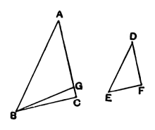

But, by hypothesis, the angle at $C$ is less than a right angle;
therefore the angle $BGC$ is also less than a right angle;
so that the angle $AGB$ adjacent to it is greater than a right angle. [I. 13]

And it was proved equal to the angle at $F$;
therefore the angle at $F$ is also greater than a right angle.

But it is by hypothesis less than a right angle: which is absurd.

Therefore the angle $ABC$ is not unequal to the angle $DEF$;
therefore it is equal to it.

But the angle at $A$ is also equal to the angle at $D$;
therefore the remaining angle at $C$ is equal to the remaining angle at $F$. [I. 32]

Therefore the triangle $ABC$ is equiangular with the triangle $DEF$.

But, again, let each of the angles at $C, F$ be supposed not less than a right angle;
I say again that, in this case too, the triangle $ABC$ is equiangular with the triangle $DEF$.

For, with the same construction,
we can prove similarly that
$$BC \text{ is equal to } BG\text{;}$$
so that the angle at $C$ is also equal to the angle $BGC$. [I. 5]

But the angle at $C$ is not less than a right angle;
therefore neither is the angle $BGC$ less than a right angle.

Thus in the triangle $BGC$ the two angles are not less than two right angles: which is impossible. [I. 17]

Therefore, once more, the angle $ABC$ is not unequal to the angle $DEF$;
therefore it is equal to it.

But the angle at $A$ is also equal to the angle at $D$;
therefore the remaining angle at $C$ is equal to the remaining angle at $F$. [I. 32]
