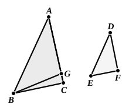

But, by hypothesis, the angle at $C$ is less than a right 
angle;

therefore the angle $BGC$ is also less than a right angle;

so that the angle $AGB$ adjacent to it is greater than a right 
angle. [I. 13]

And it was proved equal to the angle at $F$;

therefore the angle at $F$ is also greater than a right angle.

But it is by hypothesis less than a right angle: which is 
absurd.

Therefore the angle $ABC$ is not unequal to the angle 
$DEF$;

therefore it is equal to it.

But the angle at $A$ is also equal to the angle at $D$;

therefore the remaining angle at $C$ is equal to the remaining 
angle at $F$. [I. 32]

Therefore the triangle ">$ABC$ is equiangular with the triangle 
">$DEF$.

But, again, let each of the angles at $C$, $F$ be supposed not 
less than a right angle;
I say again that, in this case too, the 
triangle ">$ABC$ is equiangular with the 
triangle ">$DEF$.

For, with the same construction, 
we can prove similarly that

$BC$ is equal to $BG$;

so that the angle at $C$ is also equal to 
the angle $BGC$. [I. 5]

But the angle at $C$ is not less than a right angle;

therefore neither is the angle $BGC$ less than a right angle.

Thus in the triangle ">$BGC$ the two angles are not less 
than two right angles: which is impossible. [I. 17]

Therefore, once more, the angle $ABC$ is not unequal to 
the angle $DEF$;

therefore it is equal to it.

But the angle at $A$ is also equal to the angle at $D$;

therefore the remaining angle at $C$ is equal to the remaining 
angle at $F$. [I. 32]

