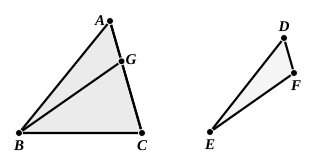

Therefore the triangle ">$ABC$ is equiangular with the triangle 
">$DEF$.

Therefore etc.Q. E. D.

---

Todhunter points out, after Walker, that some more words are necessary 
to make the enunciation precise: "If two triangles have one angle equal to one 
angle, the sides about other angles proportional <*so that the sides subtending* 
*the equal angles are homologous*>...."

This proposition is the extension to similar triangles of the *ambiguous case* 
already mentioned as omitted by Euclid in relation to *equality* of triangles in 
all respects (cf. note following I. 26, Vol. I. p. 306). The enunciation of VI. 7 
has suggested the ordinary method of enunciating the *ambiguous case* where 
*equality* and not similarity is in question. Cf. Todhunter's note on I. 26.

Another possible way of presenting this proposition is given by Todhunter. 
The essential theorem to prove is:

*If two triangles have two sides of the one proportional to two sides of the* 
*other, and the angles opposite to one pair of corresponding sides equal, the angles* 
*which are opposite to the other pair of corresponding sides shall either be equal or* 
*be together equal to two right angles.*

For the angles included by the proportional sides must be either equal or 
unequal.

If they are equal, then, since the triangles have two angles of the one 
equal to two angles of the other, respectively, they are equiangular to one 
another.

We have therefore only to consider the case in which the angles included 
by the proportional sides are unequal.

The proof is, except at the end, like that of VI. 7.

Let the triangles ">$ABC$, ">$DEF$ have the angle at $A$ equal to the angle at $D$;

let $AB$ be to $BC$ as $DE$ to $EF$,

but let the angle $ABC$ be *not* equal to the angle $DEF$.

The angles $ACB$, $DFE$ shall be together equal to two right angles.

For one of the angles $ABC$, $DEF$ must be the greater.

Let $ABC$ be the greater; and make the angle $ABG$ equal to the angle 
$DEF$.

Then we prove, as in VI. 7, that the triangles ">$ABG$, ">$DEF$ are equiangular, 
whence

$AB$ is to $BG$ as $DE$ to $EF$.

But $AB$ is to $BC$ as $DE$ to $EF$, by hypothesis.

Therefore $BG$ is equal to $BC$, 
and the angle $BGC$ is equal to the angle $BCA$.

