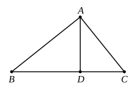

For, since the angle $BAC$ is equal to the angle $ADB$, for each is right,
and the angle at $B$ is common to the two triangles $ABC$ and $ABD$,
therefore the remaining angle $ACB$ is equal to the remaining angle $BAD$; [I. 32]
therefore the triangle $ABC$ is equiangular with the triangle $ABD$.

Therefore, as $BC$ which subtends the right angle in the triangle $ABC$ is to $BA$ which subtends the right angle in the triangle $ABD$, so is $AB$ itself which subtends the angle at $C$ in the triangle $ABC$ to $BD$ which subtends the equal angle $BAD$ in the triangle $ABD$, and so also is $AC$ to $AD$ which subtends the angle at $B$ common to the two triangles. [VI. 4]

Therefore the triangle $ABC$ is both equiangular to the triangle $ABD$ and has the sides about the equal angles proportional.

Therefore the triangle $ABC$ is similar to the triangle $ABD$. [VI. Def. 1]

Similarly we can prove that the triangle $ABC$ is also similar to the triangle $ADC$;
therefore each of the triangles $ABD$, $ADC$ is similar to the whole $ABC$.

I say next that the triangles $ABD$, $ADC$ are also similar to one another.

For, since the right angle $BDA$ is equal to the right angle $ADC$,
and moreover the angle $BAD$ was also proved equal to the angle at $C$,
therefore the remaining angle at $B$ is also equal to the remaining angle $DAC$; [I. 32]
therefore the triangle $ABD$ is equiangular with the triangle $ADC$.

Therefore, as $BD$ which subtends the angle $BAD$ in the triangle $ABD$ is to $DA$ which subtends the angle at $C$ in the triangle $ADC$ equal to the angle $BAD$, so is $AD$ itself which subtends the angle at $B$ in the triangle $ABD$ to $DC$ which subtends the angle $DAC$ in the triangle $ADC$ equal
