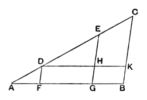

Because *ED* is parallel to one of the sides of the triangle *ABC*, viz. to *BC*,
as *CD* is to *DA*, so is *BE* to *EA*, [VI. 2]
and, *componendo*,
*CA* is to *AD*, as *BA* to *AE*. [V. 18]

But *CA* is a multiple of *AD*;
therefore *BA* is the same multiple of *AE*. [Prop. D]

Whatever part therefore *AD* is of *AC*, *AE* is the same part of *AB*;
wherefore from the straight line *AB* the part required is cut off."

The use of Simson's Prop. D can be avoided, as noted by Camerer after Baermann, in the following way. We first prove, as above, that
*CA* is to *AD* as *BA* is to *AE*.

Then we infer that, alternately,
*CA* is to *BA* as *AD* to *AE*. [V. 16]

But *AD* is to *AE* as *n* . *AD* to *n* . *AE*
(where *n* is the number of times that *AD* is contained in *AC*); [V. 15]
whence *AC* is to *AB* as *n* . *AD* is to *n* . *AE*. [V. 11]

In this proportion the first term is equal to the third; therefore the second is equal to the fourth, [V. 14]
so that *AB* is equal to *n* times *AE*.

Prop. 9 is of course only a particular case of Prop. 10.

---

### PROPOSITION 10.

*To cut a given uncut straight line similarly to a given cut straight line.*

Let *AB* be the given uncut straight line, and *AC* the straight line cut at the points *D*, *E*; and let them be so placed as to contain any angle;
let *CB* be joined, and through *D*, *E* let *DF*, *EG* be drawn parallel to *BC*, and through *D* let *DHK* be drawn parallel to *AB*. [I. 31]

Therefore each of the figures *FH*, *HB* is a parallelogram;
therefore *DH* is equal to *FG* and *HK* to *GB*. [I. 34]

Now, since the straight line *HE* has been drawn parallel to *KC*, one of the sides of the triangle *DKC*,
therefore, proportionally, as *CE* is to *ED*, so is *KH* to *HD*. [VI. 2]
