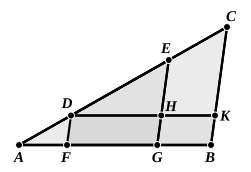

Because $ED$ is parallel to one of the sides of the triangle $ABC$, viz. to $BC$,
as $CD$ is to $DA$, so is $BE$ to $EA$, [VI. 2]
and, *componendo*,
$CA$ is to $AD$, as $BA$ to $AE$. [V. 18]

But $CA$ is a multiple of $AD$;
therefore $BA$ is the same multiple of $AE$. [Prop. D]

Whatever part therefore $AD$ is of $AC$, $AE$ is the same part of $AB$;
wherefore from the straight line $AB$ the part required is cut off."

The use of Simson's Prop. D can be avoided, as noted by Camerer after Baermann, in the following way. We first prove, as above, that
$CA$ is to $AD$ as $BA$ is to $AE$.

Then we infer that, alternately,
$CA$ is to $BA$ as $AD$ to $AE$. [V. 16]

But $AD$ is to $AE$ as $n \cdot$ $AD$ to $n \cdot$ $AE$
(where $n$ is the number of times that $AD$ is contained in $AC$); [V. 15]
whence $AC$ is to $AB$ as $n \cdot$ $AD$ is to $n \cdot$ $AE$. [V. 11]

In this proportion the first term is equal to the third; therefore the second is equal to the fourth, [V. 14]
so that $AB$ is equal to $n$ times $AE$.

Prop. 9 is of course only a particular case of Prop. 10.

---

### PROPOSITION 10.

*To cut a given uncut straight line similarly to a given cut straight line.*

Let $AB$ be the given uncut straight line, and $AC$ the straight line cut at the points $D$, $E$; and let them be so placed as to contain any angle;
let $CB$ be joined, and through $D$, $E$ let $DF$, $EG$ be drawn parallel to $BC$, and through $D$ let $DHK$ be drawn parallel to $AB$. [I. 31]

Therefore each of the figures $FH$, $HB$ is a parallelogram;
therefore $DH$ is equal to $FG$ and $HK$ to $GB$. [I. 34]

Now, since the straight line $HE$ has been drawn parallel to $KC$, one of the sides of the triangle $DKC$,
therefore, proportionally, as $CE$ is to $ED$, so is $KH$ to $HD$. [VI. 2]
