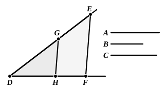
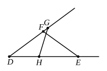

### PROPOSITION 12.

*To three given straight lines to find a fourth proportional.*

Let *A*, *B*, *C* be the three given straight lines;
thus it is required to find a fourth proportional to *A*, *B*, *C*.

Let two straight lines *DE*, *DF* be set out containing any angle *EDF*;
let *DG* be made equal to *A*, *GE* equal to *B*, and further *DH* equal to *C*;
let *GH* be joined, and let *EF* be drawn through *E* parallel to it. [I. 31]

Since, then, *GH* has been drawn parallel to *EF*, one of the sides of the triangle *DEF*,
therefore, as *DG* is to *GE*, so is *DH* to *HF*. [VI. 2]

But *DG* is equal to *A*, *GE* to *B*, and *DH* to *C*;
therefore, as *A* is to *B*, so is *C* to *HF*.

Therefore to the three given straight lines *A*, *B*, *C* a fourth proportional *HF* has been found.

Q. E. F.

---

We have here the geometrical equivalent of the "rule of three."

It is of course immaterial whether, as in Euclid's proof, the first and second straight lines are measured on one of the lines forming the angle and the third on the other, or the first and third are measured on one and the second on the other.

If it should be desired that the first and the required fourth be measured on one of the lines, and the second and third on the other, we can use the following construction. Measure *DE* on one straight line equal to *A*, and on any other straight line making an angle with the first at the point *D* measure *DF* equal to *B*, and *DG* equal to *C*. Join *EF*, and through *G* draw *GH* anti-parallel to *EF*, i.e. make the angle *DGH* equal to the angle *DEF*; let *GH* meet *DE* (produced if necessary) in *H*.

