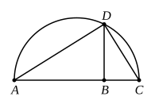

$DH$ is then the fourth proportional.

For the triangles ">$EDF$, ">$GDH$ are similar, and the sides about the equal angles are proportional, so that

$DE$ is to $DF$ as $DG$ to $DH$,

or

$A$ is to $B$ as $C$ to $DH$.

---

### PROPOSITION 13.

*To two given straight lines to find a mean proportional.*

Let $AB$, $BC$ be the two given straight lines;
thus it is required to find a mean proportional to $AB$, $BC$.

Let them be placed in a straight line, and let the semicircle $ADC$ be described on $AC$;
let $BD$ be drawn from the point $B$ at right angles to the straight line $AC$, and let $AD$, $DC$ be joined.

Since the angle $ADC$ is an angle in a semicircle, it is right. [III. 31]

And, since, in the right-angled triangle ">$ADC$, $DB$ has been drawn from the right angle perpendicular to the base, therefore $DB$ is a mean proportional between the segments of the base, $AB$, $BC$. [VI. 8, Por.]

Therefore to the two given straight lines $AB$, $BC$ a mean proportional $DB$ has been found.

$$\text{Q. E. F.}$$

---

This proposition, the Book VI. version of II. 14, is equivalent to the extraction of the square root. It further enables us, given a ratio between straight lines, to find the ratio which is its *sub-duplicate*, or the ratio of which it is *duplicate*.

---

### PROPOSITION 14.

*In equal and equiangular parallelograms the sides about the equal angles are reciprocally proportional; and equiangular parallelograms in which the sides about the equal angles are reciprocally proportional are equal.*
