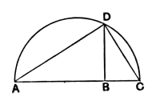

*DH* is then the fourth proportional.

For the triangles *EDF*, *GDH* are similar, and the sides about the equal angles are proportional, so that

$$\text{DE is to } DF \text{ as } DG \text{ to } DH,$$

or

$$A \text{ is to } B \text{ as } C \text{ to } DH.$$

---

### PROPOSITION 13.

*To two given straight lines to find a mean proportional.*

Let *AB*, *BC* be the two given straight lines;
thus it is required to find a mean proportional to *AB*, *BC*.

Let them be placed in a straight line, and let the semicircle *ADC* be described on *AC*;
let *BD* be drawn from the point *B* at right angles to the straight line *AC*, and let *AD*, *DC* be joined.

Since the angle *ADC* is an angle in a semicircle, it is right. [III. 31]

And, since, in the right-angled triangle *ADC*, *DB* has been drawn from the right angle perpendicular to the base, therefore *DB* is a mean proportional between the segments of the base, *AB*, *BC*. [VI. 8, Por.]

Therefore to the two given straight lines *AB*, *BC* a mean proportional *DB* has been found.

$$\text{Q. E. F.}$$

---

This proposition, the Book VI. version of II. 14, is equivalent to the extraction of the square root. It further enables us, given a ratio between straight lines, to find the ratio which is its *sub-duplicate*, or the ratio of which it is *duplicate*.

---

### PROPOSITION 14.

*In equal and equiangular parallelograms the sides about the equal angles are reciprocally proportional; and equiangular parallelograms in which the sides about the equal angles are reciprocally proportional are equal.*
