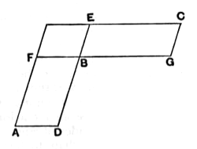

Let *AB*, *BC* be equal and equiangular parallelograms having the angles at *B* equal, and let *DB*, *BE* be placed in a straight line;
therefore *FB*, *BG* are also in a straight line. [I. 14]

I say that, in *AB*, *BC*, the sides about the equal angles are reciprocally proportional, that is to say, that, as *DB* is to *BE*, so is *GB* to *BF*.

For let the parallelogram *FE* be completed.

Since, then, the parallelogram *AB* is equal to the parallelogram *BC*,
and *FE* is another area,
therefore, as *AB* is to *FE*, so is *BC* to *FE*. [V. 7]

But, as *AB* is to *FE*, so is *DB* to *BE*, [VI. 1]
and, as *BC* is to *FE*, so is *GB* to *BF*. [*id.*]
therefore also, as *DB* is to *BE*, so is *GB* to *BF*. [V. 11]

Therefore in the parallelograms *AB*, *BC* the sides about the equal angles are reciprocally proportional.

Next, let *GB* be to *BF* as *DB* to *BE*;
I say that the parallelogram *AB* is equal to the parallelogram *BC*.

For since, as *DB* is to *BE*, so is *GB* to *BF*,
while, as *DB* is to *BE*, so is the parallelogram *AB* to the parallelogram *FE*, [VI. 1]
and, as *GB* is to *BF*, so is the parallelogram *BC* to the parallelogram *FE*, [VI. 1]
therefore also, as *AB* is to *FE*, so is *BC* to *FE*; [V. 11]
therefore the parallelogram *AB* is equal to the parallelogram *BC*. [V. 9]

Therefore etc.

$$\text{Q. E. D.}$$

---

De Morgan says upon this proposition: “Owing to the disjointed manner in which Euclid treats compound ratio, this proposition is strangely out of place. It is a particular case of VI. 23, being that in which the ratio of the sides, compounded, gives a ratio of equality. The proper definition of four magnitudes being reciprocally proportional is that the ratio compounded of their ratios is that of equality.”
