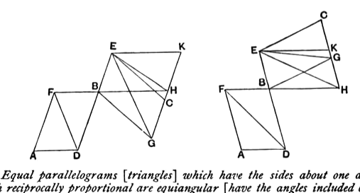

It is true that VI. 14 is a particular case of VI. 23, but, if either is out of place, it is rather the latter that should be placed before VI. 14, since most of the propositions between VI. 15 and VI. 23 depend upon VI. 14 and 15. But is perfectly consistent with Euclid's manner to give a particular case first and its extension later, and such an arrangement often has great advantages in that it enables the more difficult parts of a subject to be led up to more easily and gradually. Now, if De Morgan's view were here followed, we should, as it seems to me, be committing the mistake of explaining what is relatively easy to understand, viz. two ratios of which one is the inverse of the other, by a more complicated conception, that of compound ratio. In other words, it is easier for a learner to realise the relation indicated by the statement that the sides of equal and equiangular parallelograms are “reciprocally proportional” than to form a conception of parallelograms such that “the ratio compounded of the ratio of their sides is one of equality.” For this reason I would adhere to Euclid's arrangement.

The conclusion that, since *DB*, *BE* are placed in a straight line, *FB*, *BG* are also in a straight line is referred to I. 14. The deduction is made clearer by the following steps.

The angle *DBF* is equal to the angle *GBE*;
add to each the angle *FBE*;
therefore the angles *DBF*, *FBE* are together equal to the angles *GBE*, *FBE*. [C. N. 2]

But the angles *DBF*, *FBE* are together equal to two right angles, [I. 13]
therefore the angles *GBE*, *FBE* are together equal to two right angles, [C. N. 1]
and hence *FB*, *BG* are in one straight line. [I. 14]

The result is also obvious from the converse of I. 15 given by Proclus (see note on I. 15).

The proposition VI. 14 contains a theorem and one partial converse of it; so also does VI. 15. To each proposition may be added the other partial converse, which may be enunciated as follows, the words in square brackets applying to the case of triangles (VI. 15).

*Equal parallelograms [triangles] which have the sides about one angle in each reciprocally proportional are equiangular [have the angles included by those sides either equal or supplementary].*

Let *AB*, *BC* be equal parallelograms, or let *FBD*, *EBG* be equal
