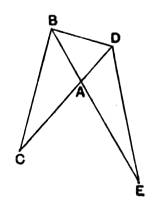

For let them be placed so that *CA* is in a straight line with *AD*; therefore *EA* is also in a straight line with *AB*. [I. 14]

Let *BD* be joined.

Since then the triangle *ABC* is equal to the triangle *ADE*, and *BAD* is another area, therefore, as the triangle *CAB* is to the triangle *BAD*, so is the triangle *EAD* to the triangle *BAD*. [V. 7]

But, as *CAB* is to *BAD*, so is *CA* to *AD*, [VI. 1]
and, as *EAD* is to *BAD*, so is *EA* to *AB*. [*id.*]
Therefore also, as *CA* is to *AD*, so is *EA* to *AB*. [V. 11]

Therefore in the triangles *ABC*, *ADE* the sides about the equal angles are reciprocally proportional.

Next, let the sides of the triangles *ABC*, *ADE* be reciprocally proportional, that is to say, let *EA* be to *AB* as *CA* to *AD*;
I say that the triangle *ABC* is equal to the triangle *ADE*.

For, if *BD* be again joined,
since, as *CA* is to *AD*, so is *EA* to *AB*,
while, as *CA* is to *AD*, so is the triangle *ABC* to the triangle *BAD*,
and, as *EA* is to *AB*, so is the triangle *EAD* to the triangle *BAD*, [VI. 1]
therefore, as the triangle *ABC* is to the triangle *BAD*, so is the triangle *EAD* to the triangle *BAD*. [V. 11]

Therefore each of the triangles *ABC*, *EAD* has the same ratio to *BAD*.

Therefore the triangle *ABC* is equal to the triangle *EAD*. [V. 9]

Therefore etc.

$$\text{Q. E. D.}$$

---

As indicated in the partial converse given in the last note, this proposition is equally true if the angle included by the two sides in one triangle is supplementary, instead of being equal, to the angle included by the two sides in the other.
