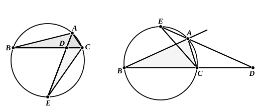

*AD* meeting *BC* (*produced if necessary*) in *D* and *AE* meeting the circle again 
in *E*, such that the angles *DAB*, *EAC* are equal, then the rectangle *AD*, *AE* is 
equal to the rectangle *BA*, *AC*.

Join *CE*.

The angles *BAD*, *EAC* are equal, by hypothesis; 
and the angles *ABD*, *AEC* are equal. [III. 21, 22]

Therefore the triangles *ABD*, *AEC* are equiangular.

Hence

*BA* is to *AD* as *EA* is to *AC*,

and therefore the rectangle *BA*, *AC* is equal to the rectangle *AD*, *AE*. 
[VI. 16]

There are now two particular cases to be considered.

(*a*) Suppose that *AD*, *AE* coincide; 
*ADE* will then bisect the angle *BAC*.

(*b*) Suppose that *AD*, *AE* are in one straight line but that *D*, *E* are on 
opposite sides of *A*; 
*AD* will then bisect the external angle at *A*.

In the first case (*a*) we have

the rectangle *BA*, *AC* equal to the rectangle *EA*, *AD*;

and the rectangle *EA*, *AD* is equal to the rectangle *ED*, *DA* together with 
the square on *AD*, [II. 3] 
i.e. to the rectangle *BD*, *DC* together with the square on *AD*. [III. 35]

Therefore the rectangle *BA*, *AC* is equal to the rectangle *BD*, *DC* 
together with the square on *AD*. [This is Simson's Prop. B]

In case (*b*) the rectangle *EA*, *AD* is equal to the excess of the rectangle 
*ED*, *DA* over the square on *AD*;

therefore the rectangle *BA*, *AC* is equal to the excess of the rectangle *BD*, 
*DC* over the square on *AD*.

