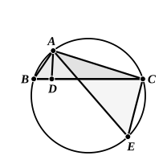

*AD meeting BC (produced if necessary) in D and AE meeting the circle again in E, such that the angles DAB, EAC are equal, then the rectangle AD, AE is equal to the rectangle BA, AC.*

Join *CE*.

The angles *BAD*, *EAC* are equal, by hypothesis;
and the angles *ABD*, *AEC* are equal. [III. 21, 22]

Therefore the triangles *ABD*, *AEC* are equiangular.
Hence

$$BA \text{ is to } AD \text{ as } EA \text{ is to } AC,$$

and therefore the rectangle *BA*, *AC* is equal to the rectangle *AD*, *AE*. [VI. 16]

There are now two particular cases to be considered.

(a) Suppose that *AD*, *AE* coincide;
*ADE* will then bisect the angle *BAC*.

(b) Suppose that *AD*, *AE* are in one straight line but that *D*, *E* are on opposite sides of *A*;
*AD* will then bisect the external angle at *A*.

In the first case (a) we have the rectangle *BA*, *AC* equal to the rectangle *EA*, *AD*;
and the rectangle *EA*, *AD* is equal to the rectangle *ED*, *DA* together with the square on *AD*, [II. 3]
i.e. to the rectangle *BD*, *DC* together with the square on *AD*. [III. 35]
Therefore the rectangle *BA*, *AC* is equal to the rectangle *BD*, *DC* together with the square on *AD*. [This is Simson's Prop. B]

In case (b) the rectangle *EA*, *AD* is equal to the excess of the rectangle *ED*, *DA* over the square on *AD*;
therefore the rectangle *BA*, *AC* is equal to the excess of the rectangle *BD*, *DC* over the square on *AD*.
