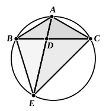
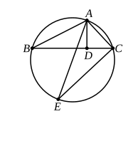
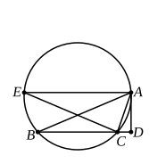

The following converse of Simson's Prop. B may be given: *If a straight 
line $AD$ be drawn from the vertex $A$ of a triangle to meet the base, so that the 
square on $AD$ together with the rectangle $BD$, $DC$ is equal to the rectangle $BA$, 
$AC$, the line $AD$ will bisect the angle $BAC$ except when the sides $AB$, $AC$ are 
equal, in which case every line drawn to the base will have the property men- 
tioned.*

Let the circumscribed circle be drawn, and let $AD$ produced meet it in 
$E$; join $CE$.

The rectangle $BD$, $DC$ is equal to the rectangle $ED$, $DA$. [III. 35]

Add to each the square on $AD$; 

therefore the rectangle $BA$, $AC$ is equal to the rectangle $EA$, $AD$. 
[hyp. and II. 3]

Hence

$AB$ is to $AD$ as $AE$ to $AC$. [VI. 16]

But the angle $ABD$ is equal to the angle $AEC$. [III. 21]

Therefore the angles $BDA$, $ECA$ are either equal or supplementary. 
[VI. 7 and note]

(*a*) If they are equal, the angles $BAD$, $EAC$ 
are also equal, and $AD$ bisects the angle $BAC$.

(*b*) If they are supplementary, the angle $ADC$ 
must be equal to the angle $ACE$.

Therefore the angles $BAD$, $ABD$ are together 
equal to the angles $ACB$, $BCE$, i.e. to the angles 
$ACD$, $BAD$.

Take away the common angle $BAD$, and

the angles $ABD$, $ACD$ are equal, or 
$AB$ is equal to $AC$.

Euclid himself assumes, in Prop. 67 of the $Data$, the result of so much of 
this proposition as relates to the case where $BA$ = $AC$. He assumes namely, 
without proof, that, if $BA$ = $AC$, and if $D$ be any point on $BC$, the rectangle 
$BD$, $DC$ together with the square on $AD$ is equal to the square on $AB$.

---

### PROPOSITION C.

If from any angle of a triangle a straight line be drawn perpendicular to the 
opposite side, the rectangle contained by the other two sides of the triangle is equal 
to the rectangle contained by the perpendicular and the diameter of the circle 
circumscribed about the triangle.

Let ">$ABC$ be a triangle and $AD$ the perpendicular on $BC$. Draw the 
diameter $AE$ of the circle circumscribed about the triangle ">$ABC$.

Then shall the rectangle $BA$, $AC$ be equal to the rectangle $EA$, $AD$.

Join $EC$.
