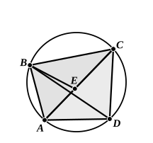

Since the right angle $BDA$ is equal to the right angle $ECA$ in a semi-circle, [III. 31]
and the angles $ABD$, $AEC$ in the same segment are equal, [III. 21]
$$\text{the triangles ">$ABD$, ">$AEC$ are equiangular.}$$
Therefore,
$$\text{as $BA$ is to $AD$, so is $EA$ to $AC$,}\quad\text{[VI. 4]}$$
whence the rectangle $BA$, $AC$ is equal to the rectangle $EA$, $AD$. [VI. 16]

This result corresponds to the trigonometrical formula for $R$, the radius of the circumscribed circle,
$$R = \frac{abc}{4\Delta}.$$

---

### PROPOSITION D.

This is the highly important lemma given by Ptolemy (ed. Heiberg, Vol. I, pp. 36—7) which is the basis of his calculation of the table of chords in the section of Book I. of the μεγάλη σύνταξις entitled "concerning the size of the straight lines [i.e. chords] in the circle" (περὶ τῆς πηλικότητος τῶν ἐν τῷ κύκλῳ εὐθειῶν).

The theorem may be enunciated thus.

*The rectangle contained by the diagonals of any quadrilateral inscribed in a circle is equal to the sum of the rectangles contained by the pairs of opposite sides.*

I shall give the proof in Ptolemy's words, with the addition only, in brackets, of two words applying to a second figure not given by Ptolemy.

"Let there be a circle with any quadrilateral ">$ABCD$ inscribed in it, and let $AC$, $BD$ be joined.

It is to be proved that the rectangle contained by $AC$ and $BD$ is equal to the sum of the rectangles $AB$, $DC$ and $AD$, $BC$.

For let the angle $ABE$ be made equal to the angle contained by $DB$, $BC$.

If then we add [or subtract] the angle $EBD$,
the angle $ABD$ will also be equal to the angle $EBC$.

But the angle $BDA$ is also equal to the angle $BCE$, [III. 21]
for they subtend the same segment;
therefore the triangle ">$ABD$ is equiangular with the triangle ">$EBC$.

Hence, proportionally,
$$\text{as $BC$ is to $CE$, so is $BD$ to $DA$.}\quad\text{[VI. 4]}$$

Therefore the rectangle $BC$, $AD$ is equal to the rectangle $BD$, $CE$. [VI. 16]

Again, since the angle $ABE$ is equal to the angle $DBC$,
and the angle $BAE$ is also equal to the angle $BDC$, [III. 21]
$$\text{the triangle ">$ABE$ is equiangular with the triangle ">$DBC$.}$$
