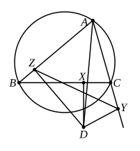
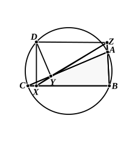

Therefore, proportionally,

as $BA$ is to $AE$, so is $BD$ to $DC$; [VI. 4]

therefore the rectangle $BA$, $DC$ is equal to the rectangle $BD$, $AE$. [VI. 16]

But it was also proved that

the rectangle $BC$, $AD$ is equal to the rectangle $BD$, $CE$;

therefore the rectangle $AC$, $BD$ as a whole is equal to the sum of the rectangles $AB$, $DC$ and $AD$, $BC$:

(being) what it was required to prove."

Another proof of this proposition, and of its converse, is indicated by Dr Lachlan (*Elements of Euclid*, pp. 273—4). It depends on two preliminary propositions.

(1) *If two circles be divided, by a chord in each, into segments which are similar respectively, the chords are proportional to the corresponding diameters.*

The proof is instantaneous if we join the ends of each chord to the centre of the circle which it divides, when we obtain two similar triangles.

(2) *If $D$ be any point on the circle circumscribed about a triangle $ABC$, and $DX$, $DY$, $DZ$ be perpendicular to the sides $BC$, $CA$, $AB$ of the triangle respectively, then $X$, $Y$, $Z$ lie in one straight line; and, conversely, if the feet of the perpendiculars from any point $D$ on the sides of a triangle lie in one straight line, $D$ lies on the circle circumscribed about the triangle.*

The proof depending on III. 21, 22 is well known.

Now suppose that $D$ is any point in the plane of a triangle $ABC$, and that $DX$, $DY$, $DZ$ are perpendicular to the sides $BC$, $CA$, $AB$ respectively.

Join $YZ$, $DA$.

Then, since the angles at $Y$, $Z$ are right, $A$, $Y$, $D$, $Z$ lie on a circle of which $DA$ is the diameter.

And $YZ$ divides this circle into segments which are similar respectively to the segments into which $BC$ divides the circle circumscribing $ABC$, since the angles $ZAY$, $BAC$ coincide, and their supplements are equal.

Therefore, if $d$ be the diameter of the circle circumscribing $ABC$,

$BC$ is to $d$ as $YZ$ is to $DA$;

and therefore the rectangle $AD$, $BC$ is equal to the rectangle $d$, $YZ$.

Similarly the rectangle $BD$, $CA$ is equal to the rectangle $d$, $ZX$, and the rectangle $CD$, $AB$ is equal to the rectangle $d$, $XY$.

Hence, in a quadrilateral in general, the rectangle contained by the diagonals is less than the sum of the rectangles contained by the pairs of opposite sides.

Next, suppose that $D$ lies on the circle circumscribed about $ABC$, but so that $A$, $B$, $C$, $D$ follow each other on the circle in this order, as in the figure annexed.

Let $DX$, $DY$, $DZ$ be perpendicular to $BC$, $CA$, $AB$ respectively, so that $X$, $Y$, $Z$ are in a straight line.

Then, since the rectangles $AD$, $BC$; $BD$, $CA$; $CD$, $AB$ are equal to the rectangles $d$, $YZ$; $d$, $ZX$; $d$, $XY$ respectively, and $XZ$ is equal to the sum of
