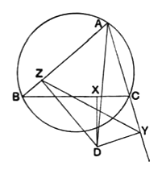
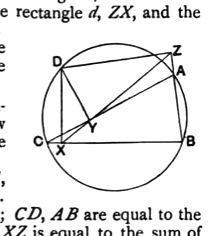

Therefore, proportionally,
$$\text{as \textit{BA} is to \textit{AE}, so is \textit{BD} to \textit{DC};}\quad\text{[VI. 4]}$$
therefore the rectangle *BA*, *DC* is equal to the rectangle *BD*, *AE*. [VI. 16]

But it was also proved that
$$\text{the rectangle \textit{BC}, \textit{AD} is equal to the rectangle \textit{BD}, \textit{CE};}$$
therefore the rectangle *AC*, *BD* as a whole is equal to the sum of the rectangles *AB*, *DC* and *AD*, *BC*:
$$\text{(being) what it was required to prove."}$$

Another proof of this proposition, and of its converse, is indicated by Dr Lachlan (*Elements of Euclid*, pp. 273—4). It depends on two preliminary propositions.

(1) *If two circles be divided, by a chord in each, into segments which are similar respectively, the chords are proportional to the corresponding diameters.*

The proof is instantaneous if we join the ends of each chord to the centre of the circle which it divides, when we obtain two similar triangles.

(2) *If D be any point on the circle circumscribed about a triangle ABC, and DX, DY, DZ be perpendicular to the sides BC, CA, AB of the triangle respectively, then X, Y, Z lie in one straight line; and, conversely, if the feet of the perpendiculars from any point D on the sides of a triangle lie in one straight line, D lies on the circle circumscribed about the triangle.*

The proof depending on III. 21, 22 is well known.

Now suppose that *D* is any point in the plane of a triangle *ABC*, and that *DX*, *DY*, *DZ* are perpendicular to the sides *BC*, *CA*, *AB* respectively.

Join *YZ*, *DA*.

Then, since the angles at *Y*, *Z* are right, *A*, *Y*, *D*, *Z* lie on a circle of which *DA* is the diameter.

And *YZ* divides this circle into segments which are similar respectively to the segments into which *BC* divides the circle circumscribing *ABC*, since the angles *ZAY*, *BAC* coincide, and their supplements are equal.

Therefore, if $d$ be the diameter of the circle circumscribing *ABC*,
$$\text{\textit{BC} is to $d$ as \textit{YZ} is to \textit{DA};}$$
and therefore the rectangle *AD*, *BC* is equal to the rectangle $d$, *YZ*.

Similarly the rectangle *BD*, *CA* is equal to the rectangle $d$, *ZX*, and the rectangle *CD*, *AB* is equal to the rectangle $d$, *XY*.

Hence, in a quadrilateral in general, the rectangle contained by the diagonals is less than the sum of the rectangles contained by the pairs of opposite sides.

Next, suppose that *D* lies on the circle circumscribed about *ABC*, but so that *A*, *B*, *C*, *D* follow each other on the circle in this order, as in the figure annexed.

Let *DX*, *DY*, *DZ* be perpendicular to *BC*, *CA*, *AB* respectively, so that *X*, *Y*, *Z* are in a straight line.

Then, since the rectangles *AD*, *BC*; *BD*, *CA*; *CD*, *AB* are equal to the rectangles $d$, *YZ*; $d$, *ZX*; $d$, *XY* respectively, and *XZ* is equal to the sum of
