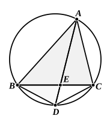

*XY*, *YZ*, so that the rectangle *d*, *XZ* is equal to the sum of the rectangles 
*d*, *XY* and *d*, *YZ*, it follows that

the rectangle *AC*, *BD* is equal to the sum of the rectangles *AD*, *BC* and 
*AB*, *CD*.

*Conversely*, if the latter statement is true, while we are supposed to know 
nothing about the position of *D*, it follows that

*XZ* must be equal to the sum of *XY*, *YZ*,

so that *X*, *Y*, *Z* must be in a straight line.

Hence, from the theorem (2) above, it follows that *D* must lie on the 
circle circumscribed about *ABC*, *i.e.* that *ABCD* is a quadrilateral about 
which a circle can be described.

All the above propositions can be proved on the basis of Book III. and 
without using Book VI., since it is possible by the aid of III. 21 and 35 alone 
to prove that *in equiangular triangles the rectangles contained by the non- 
corresponding sides about equal angles are equal to one another* (a result arrived 
at by combining VI. 4 and VI. 16). This is the method adopted by Casey, 
H. M. Taylor, and Lachlan; but I fail to see any particular advantage in it.

---

### PROPOSITION E.

Lastly, the following proposition may be given which Playfair added as 
VI. E. It appears in the *Data* of Euclid, Prop. 93, and may be thus 
enunciated.

If the angle *BAC* of a triangle *ABC* be bisected by the straight line *AD* 
meeting the circle circumscribed about the triangle in *D*, and if *BD* be joined, 
then 
the sum of *BA*, *AC* is to *AD* as *BC* is to *BD*.

Join *CD*. Then, since *AD* bisects the angle *BAC*, the subtended arcs 
*BD*, *DC*, and therefore the chords *BD*, *DC*, are 
equal.

(1) The result can now be easily deduced from 
Ptolemy's theorem.

For the rectangle *AD*, *BC* is equal to the sum of 
the rectangles *AB*, *DC* and *AC*, *BD*, *i.e.* (since 
*BD*, *CD* are equal) to the rectangle contained by 
*BA* + *AC* and *BD*.

Therefore the sum of *BA*, *AC* is to *AD* as *BC* 
is to *BD*. [VI. 16]

(2) Euclid proves it differently in *Data*, Prop. 93.

Let *AD* meet *BC* in *E*.

Then, since *AE* bisects the angle *BAC*,

*BA* is to *AC* as *BE* to *EC*, [VI. 3]

or, alternately,

*AB* is to *BE* as *AC* to *CE*. [V. 16]

Therefore also

*BA* + *AC* is to *BC* as *AC* to *CE*. [V. 12]

Again, since the angles *BAD*, *EAC* are equal, and the angles *ADB*, *ACE* 
are also equal, [III. 21]

the triangles *ABD*, *AEC* are equiangular.

Therefore

*AC* is to *CE* as *AD* to *BD*. [VI. 4]

