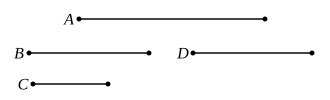

Hence

*BA* + *AC* is to *BC* as *AD* to *BD*, [V. 11]

and, alternately,

*BA* + *AC* is to *AD* as *BC* to *BD*. [V. 16]

Euclid concludes that, if the circle *ABC* is given in magnitude, and the 
chord *BC* cuts off a segment of it containing a given angle (so that, by *Data* 
Prop. 87, *BC* and also *BD* are given in magnitude),

the ratio of *BA* + *AC* to *AD* is given,

and further that (since, by similar triangles, *BD* is to *DE* as *AC* is to *CE*, 
while *BA* + *AC* is to *BC* as *AC* is to *CE*),

the rectangle (*BA* + *AC*), *DE*, being equal to the rectangle *BC*, *BD*, is 
also given.

---

### PROPOSITION 17.

If three straight lines be proportional, the rectangle con- 
tained by the extremes is equal to the square on the mean; 
and, if the rectangle contained by the extremes be equal to the 
square on the mean, the three straight lines will be proportional.

Let the three straight lines *A*, *B*, *C* be proportional, so 
that, as *A* is to *B*, so is *B* to *C*; 
I say that the rectangle contained by *A*, *C* is equal to the 
square on *B*.

Let *D* be made equal to *B*.

Then, since, as *A* is to *B*, so is *B* to *C*, 

and *B* is equal to *D*,

therefore, as *A* is to *B*, so is *D* to *C*.

But, if four straight lines be proportional, the rectangle 
contained by the extremes is equal to the rectangle contained 
by the means. [VI. 16]

Therefore the rectangle *A*, *C* is equal to the rectangle 
*B*, *D*.

But the rectangle *B*, *D* is the square on *B*, for *B* is 
equal to *D*;

therefore the rectangle contained by *A*, *C* is equal to the 
square on *B*.

Next, let the rectangle *A*, *C* be equal to the square on *B*; 
I say that, as *A* is to *B*, so is *B* to *C*.
