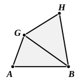

For, with the same construction,
since the rectangle $A$, $C$ is equal to the square on $B$,
while the square on $B$ is the rectangle $B$, $D$, for $B$ is equal to $D$,
therefore the rectangle $A$, $C$ is equal to the rectangle $B$, $D$.

But, if the rectangle contained by the extremes be equal to that contained by the means, the four straight lines are proportional. [VI. 16]

Therefore, as $A$ is to $B$, so is $D$ to $C$.

But $B$ is equal to $D$;
therefore, as $A$ is to $B$, so is $B$ to $C$.

Therefore etc.

Q. E. D.

---

VI. 17 is, of course, a particular case of VI. 16.

---

### PROPOSITION 18.

*On a given straight line to describe a rectilinear figure similar and similarly situated to a given rectilinear figure.*

Let $AB$ be the given straight line and $CE$ the given rectilinear figure;
thus it is required to describe on the straight line $AB$ a rectilinear figure similar and similarly situated to the rectilinear figure $CE$.

Let $DF$ be joined, and on the straight line $AB$, and at the points $A$, $B$ on it, let the angle $GAB$ be constructed equal to the angle at $C$, and the angle $ABG$ equal to the angle $CDF$. [I. 23]

Therefore the remaining angle $CFD$ is equal to the angle $AGB$; [I. 32]
therefore the triangle $FCD$ is equiangular with the triangle $GAB$.

Therefore, proportionally, as $FD$ is to $GB$, so is $FC$ to $GA$, and $CD$ to $AB$.
