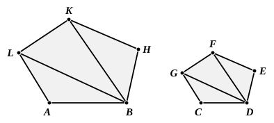
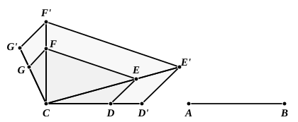

intermediate step of *alternando*, whether accidental or not, is of no importance. On the other hand, the use of this form of the proportion certainly simplifies the proof of the proposition, since it makes unnecessary the subsequent *ex aequali* steps of Simson's proof, their place being taken by the inference [V. 11] that ratios which are the same with a third ratio are the same with one another.

Nor is the first objection of any importance. We have only to take as the

given polygon a polygon of five sides at least, as ">$CDEFG$, join one extremity of $CD$, say $D$, to each of the angular points other than $C$ and $E$, and then use the same mode of construction as Euclid's for any number of successive triangles as ">$ABL$, ">$LBK$, etc., that may have to be made. Euclid's construction and proof for a quadrilateral are quite sufficient to show how to deal with the case of a figure of five or any greater number of sides.

Clavius has a construction which, given the power of moving a figure

bodily from one position to any other, is easier. ">$CDEFG$ being the given polygon, join $CE$, $CF$. Place $AB$ on $CD$ so that $A$ falls on $C$, and let $B$ fall on $D'$, which may either lie on $CD$ or on $CD$ produced.

Now draw $D'E'$ parallel to $DE$, meeting $CE$, produced if necessary, in $E'$, $E'F'$ parallel to $EF$, meeting $CF$, produced if necessary, in $F'$, and so on.

Let the parallel to the last side but one, $FG$, meet $CG$, produced if necessary, in $G'$.

Then ">$CD'E'F'G'$ is similar and similarly situated to ">$CDEFG$, and it is constructed on $CD'$, a straight line equal to $AB$.

The proof of this is obvious.

A more general construction is indicated in the subjoined figure. If ">$CDEFG$ be the given polygon, suppose its angular points all joined to any point $O$ and the connecting straight lines produced both ways. Then, if $C'D'$, a straight line equal to $AB$, be placed so that it is parallel to $CD$, and $C'$, $D'$ lie respectively on $OC$, $OD$ (this can of course be done by finding fourth proportionals), we have only to draw $D'E'$, $E'F'$, etc., parallel to the corresponding sides of the original polygon in the manner shown.
