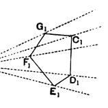
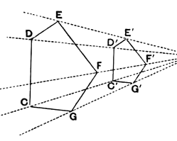

De Morgan would rearrange Props. 18 and 20 in the following manner. He would combine Prop. 18 and the first part of Prop. 20 into one, with the enunciation :

_Pairs of similar triangles, similarly put together, give similar figures ; and every pair of similar figures is composed of pairs of similar triangles similarly put together._

He would then make the _problem_ of VI. 18 an application of the first part. In form this would certainly appear to be an improvement; but, provided that the relation of the propositions is understood, the matter of form is perhaps not of great importance.

---

### PROPOSITION 19.

_Similar triangles are to one another in the duplicate ratio of the corresponding sides._

Let _ABC_, _DEF_ be similar triangles having the angle at _B_ equal to the angle at _E_, and such that, as _AB_ is to _BC_, so 5is _DE_ to _EF_, so that _BC_ corresponds to _EF_; [v. Def. 11]

I say that the triangle _ABC_ has to the triangle _DEF_ a ratio duplicate of that which _BC_ has to _EF_.

For let a third proportional _BG_ be taken to _BC_, _EF_, so that, as _BC_ is to _EF_, so is _EF_ to _BG_; [VI. 11]
10and let _AG_ be joined.

Since then, as _AB_ is to _BC_, so is _DE_ to _EF_,
therefore, alternately, as _AB_ is to _DE_, so is _BC_ to _EF_. [v. 16]
