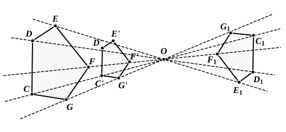

De Morgan would rearrange Props. 18 and 20 in the following manner. 
He would combine Prop. 18 and the first part of Prop. 20 into one, with the 
enunciation :

*Pairs of similar triangles, similarly put together, give similar figures ; and 
every pair of similar figures is composed of pairs of similar triangles similarly 
put together.*

He would then make the *problem* of VI. 18 an application of the first part. 
In form this would certainly appear to be an improvement; but, provided that 
the relation of the propositions is understood, the matter of form is perhaps 
not of great importance.

---

### PROPOSITION 19.

Similar triangles are to one another in the duplicate ratio 
of the corresponding sides.

Let ">$ABC$, ">$DEF$ be similar triangles having the angle at 
$B$ equal to the angle at $E$, and such that, as $AB$ is to $BC$, so 
5 is $DE$ to $EF$, so that $BC$ corresponds to $EF$; [v. Def. 11]

I say that the triangle ">$ABC$ has to the triangle ">$DEF$ a ratio 
duplicate of that which $BC$ has to $EF$.

For let a third proportional $BG$ be taken to $BC$, $EF$, so 
that, as $BC$ is to $EF$, so is $EF$ to $BG$; [VI. 11] 
10 and let $AG$ be joined.

Since then, as $AB$ is to $BC$, so is $DE$ to $EF$,

therefore, alternately, as $AB$ is to $DE$, so is $BC$ to $EF$. [v. 16]

