">$ABC$ to the triangle ">$ABG$, that is ">$DEF$." Such explanations in Porisms are 
not in Euclid's manner, and the words are not in Campanus, though they date 
from a time earlier than Theon.

---

### PROPOSITION 20.

Similar polygons are divided into similar triangles, and 
into triangles equal in multitude and in the same ratio as 
the wholes, and the polygon has to the polygon a ratio duplicate 
of that which the corresponding side has to the corresponding 
5side.

Let ">$ABCDE$, ">$FGHKL$ be similar polygons, and let $AB$ 
correspond to $FG$; 
I say that the polygons ">$ABCDE$, ">$FGHKL$ are divided into 
similar triangles, and into triangles equal in multitude and in 
10the same ratio as the wholes, and the polygon ">$ABCDE$ has 
to the polygon ">$FGHKL$ a ratio duplicate of that which $AB$ 
has to $FG$.

Let $BE$, $EC$, $GL$, $LH$ be joined.

Now, since the polygon ">$ABCDE$ is similar to the polygon 
15">$FGHKL$,

the angle $BAE$ is equal to the angle $GFL$;

and, as $BA$ is to $AE$, so is $GF$ to $FL$. [VI. Def. 1]

Since then ">$ABE$, ">$FGL$ are two triangles having one 
angle equal to one angle and the sides about the equal angles 
20proportional,

therefore the triangle ">$ABE$ is equiangular with the triangle 
">$FGL$; [VI. 6]

so that it is also similar; [VI. 4 and Def. 1]

therefore the angle $ABE$ is equal to the angle $FGL$.

