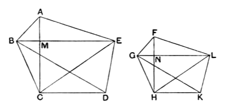

_ABC_ to the triangle _ABG_, that is _DEF_." Such explanations in Porisms are not in Euclid's manner, and the words are not in Campanus, though they date from a time earlier than Theon.

---

### PROPOSITION 20.

_Similar polygons are divided into similar triangles, and into triangles equal in multitude and in the same ratio as the wholes, and the polygon has to the polygon a ratio duplicate of that which the corresponding side has to the corresponding 5side._

Let _ABCDE_, _FGHKL_ be similar polygons, and let _AB_ correspond to _FG_;
I say that the polygons _ABCDE_, _FGHKL_ are divided into similar triangles, and into triangles equal in multitude and in 10the same ratio as the wholes, and the polygon _ABCDE_ has to the polygon _FGHKL_ a ratio duplicate of that which _AB_ has to _FG_.

Let _BE_, _EC_, _GL_, _LH_ be joined.

Now, since the polygon _ABCDE_ is similar to the polygon 15_FGHKL_,
the angle _BAE_ is equal to the angle _GFL_;
and, as _BA_ is to _AE_, so is _GF_ to _FL_. [VI. Def. 1]

Since then _ABE_, _FGL_ are two triangles having one angle equal to one angle and the sides about the equal angles 20proportional,
therefore the triangle _ABE_ is equiangular with the triangle _FGL_; [VI. 6]
so that it is also similar; [VI. 4 and Def. 1]
therefore the angle _ABE_ is equal to the angle _FGL_.
