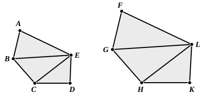

100 But the triangle *ABE* has to the triangle *FGL* a ratio 
duplicate of that which the corresponding side *AB* has to the 
corresponding side *FG*; for similar triangles are in the 
duplicate ratio of the corresponding sides. [VI. 19]

Therefore the polygon *ABCDE* also has to the polygon 
105*FGHKL* a ratio duplicate of that which the corresponding 
side *AB* has to the corresponding side *FG*.

Therefore etc.

PORISM. Similarly also it can be proved in the case of 
quadrilaterals that they are in the duplicate ratio of the 
110corresponding sides. And it was also proved in the case of 
triangles; therefore also, generally, similar rectilineal figures 
are to one another in the duplicate ratio of the corresponding 
sides.Q. E. D.

---

**2.** **in the same ratio as the wholes.** The same word ὁμόλογος is used which I have 
generally translated by "corresponding." But here it is followed by a dative, ὁμόλογα τοῖς 
ὅλοις " *homologous with the wholes*," instead of being used absolutely. The meaning can 
therefore here be nothing else but "in the same ratio with" or "proportional to the 
wholes"; and Euclid seems to recognise that he is making a special use of the word, 
because he explains it lower down (l. 46): "the triangles are homologous to the wholes, that 
is, in such manner that the triangles are proportional, and *ABE*, *EBC*, *ECD* are ante- 
cedents, while *FGL*, *LGH*, *LHK* are their consequents."

**49.** **ἑπόμενα αὐτῶν, "their consequents,"** is a little awkward, but may be supposed to 
indicate which triangles correspond to which as consequent to antecedent.

An alternative proof of the second part of this proposition given after the 
Porisms is relegated by August and Heiberg to an Appendix as an interpolation. 
It is shorter than the proof in the text, and is the only one given by many 
editors, including Clavius, Billingsley, Barrow and Simson. It runs as follows:

"We will now also prove that the triangles are homologous in another and 
an easier manner.

Again, let the polygons *ABCDE*, *FGHKL* be set out, and let *BE*, *EC*, 
*GL*, *LH* be joined.

I say that, as the triangle *ABE* is to *FGL*, so is *EBC* to *LGH* and *CDE* 
to *HKL*.

For, since the triangle *ABE* is similar to the triangle *FGL*, the triangle 
*ABE* has to the triangle *FGL* a ratio duplicate of that which *BE* has to *GL*.

