For, since $A$ is similar to $C$,
it is equiangular with it and has the sides about the equal
angles proportional. [VI. Def. 1]

Again, since $B$ is similar to $C$,
it is equiangular with it and has the sides about the equal
angles proportional.
Therefore each of the figures $A$, $B$ is equiangular with $C$
and with $C$ has the sides about the equal angles proportional;
therefore $A$ is similar to $B$.

Q. E. D.

---

It will be observed that the text above omits a step which the editions generally have before the final inference "Therefore $A$ is similar to $B$." The words omitted are "so that $A$ is also equiangular with $B$ and [with $B$] has the sides about the equal angles proportional." Heiberg follows P in leaving them out, conjecturing that they may be an addition of Theon's.

### PROPOSITION 22.

*If four straight lines be proportional, the rectilineal figures similar and similarly described upon them will also be proportional; and, if the rectilineal figures similar and similarly described upon them be proportional, the straight lines will themselves also be proportional.*

Let the four straight lines $AB$, $CD$, $EF$, $GH$ be proportional,
so that, as $AB$ is to $CD$, so is $EF$ to $GH$,
and let there be described on $AB$, $CD$ the similar and similarly situated rectilineal figures ">$KAB$, ">$LCD$,
and on $EF$, $GH$ the similar and similarly situated rectilineal figures ">$MF$, ">$NH$;
I say that, as ">$KAB$ is to ">$LCD$, so is ">$MF$ to ">$NH$.

For let there be taken a third proportional $O$ to $AB$, $CD$,
and a third proportional $P$ to $EF$, $GH$. [VI. 11]
