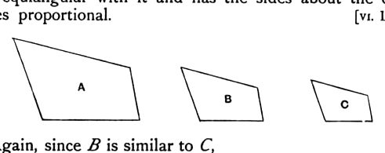

For, since *A* is similar to *C*,
it is equiangular with it and has the sides about the equal
angles proportional. [VI. Def. 1]

Again, since *B* is similar to *C*,
it is equiangular with it and has the sides about the equal
angles proportional.
Therefore each of the figures *A*, *B* is equiangular with *C*
and with *C* has the sides about the equal angles proportional;
therefore *A* is similar to *B*.

Q. E. D.

---

It will be observed that the text above omits a step which the editions generally have before the final inference "Therefore *A* is similar to *B*." The words omitted are "so that *A* is also equiangular with *B* and [with *B*] has the sides about the equal angles proportional." Heiberg follows P in leaving them out, conjecturing that they may be an addition of Theon's.

### PROPOSITION 22.

*If four straight lines be proportional, the rectilineal figures similar and similarly described upon them will also be proportional; and, if the rectilineal figures similar and similarly described upon them be proportional, the straight lines will themselves also be proportional.*

Let the four straight lines *AB*, *CD*, *EF*, *GH* be proportional,
so that, as *AB* is to *CD*, so is *EF* to *GH*,
and let there be described on *AB*, *CD* the similar and similarly situated rectilineal figures *KAB*, *LCD*,
and on *EF*, *GH* the similar and similarly situated rectilineal figures *MF*, *NH*;
I say that, as *KAB* is to *LCD*, so is *MF* to *NH*.

For let there be taken a third proportional *O* to *AB*, *CD*,
and a third proportional *P* to *EF*, *GH*. [VI. 11]
