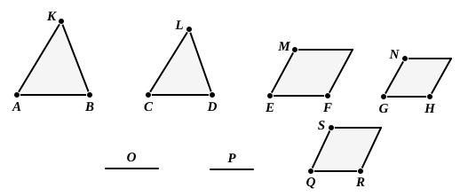

Then since, as *AB* is to *CD*, so is *EF* to *GH*, 
and, as *CD* is to *O*, so is *GH* to *P*,

therefore, *ex aequali*, as *AB* is to *O*, so is *EF* to *P*. [V. 22]

But, as *AB* is to *O*, so is *KAB* to *LCD*, 
and, as *EF* is to *P*, so is *MF* to *NH*; [VI. 19, Por.]

therefore also, as *KAB* is to *LCD*, so is *MF* to *NH*. [V. 11]

Next, let *MF* be to *NH* as *KAB* is to *LCD*; 
I say also that, as *AB* is to *CD*, so is *EF* to *GH*.

For, if *EF* is not to *GH* as *AB* to *CD*,

let *EF* be to *QR* as *AB* to *CD*, [VI. 12] 
and on *QR* let the rectilineal figure *SR* be described similar 
and similarly situated to either of the two *MF*, *NH*. [VI. 18]

Since then, as *AB* is to *CD*, so is *EF* to *QR*, 
and there have been described on *AB*, *CD* the similar and 
similarly situated figures *KAB*, *LCD*, 
and on *EF*, *QR* the similar and similarly situated figures 
*MF*, *SR*,

therefore, as *KAB* is to *LCD*, so is *MF* to *SR*.

But also, by hypothesis, 
as *KAB* is to *LCD*, so is *MF* to *NH*;

therefore also, as *MF* is to *SR*, so is *MF* to *NH*. [V. 11]

Therefore *MF* has the same ratio to each of the figures 
*NH*, *SR*;

therefore *NH* is equal to *SR*. [V. 9]

But it is also similar and similarly situated to it;

therefore *GH* is equal to *QR*.

