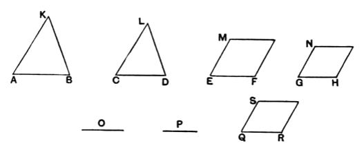

Then since, as *AB* is to *CD*, so is *EF* to *GH*,
and, as *CD* is to *O*, so is *GH* to *P*,
therefore, *ex aequali*, as *AB* is to *O*, so is *EF* to *P*. [V. 22]
But, as *AB* is to *O*, so is *KAB* to *LCD*, [VI. 19, Por.]
and, as *EF* is to *P*, so is *MF* to *NH*;
therefore also, as *KAB* is to *LCD*, so is *MF* to *NH*. [V. 11]

Next, let *MF* be to *NH* as *KAB* is to *LCD*;
I say also that, as *AB* is to *CD*, so is *EF* to *GH*.

For, if *EF* is not to *GH* as *AB* to *CD*,
let *EF* be to *QR* as *AB* to *CD*, [VI. 12]
and on *QR* let the rectilineal figure *SR* be described similar
and similarly situated to either of the two *MF*, *NH*. [VI. 18]

Since then, as *AB* is to *CD*, so is *EF* to *QR*,
and there have been described on *AB*, *CD* the similar and
similarly situated figures *KAB*, *LCD*,
and on *EF*, *QR* the similar and similarly situated figures
*MF*, *SR*,
therefore, as *KAB* is to *LCD*, so is *MF* to *SR*.
But also, by hypothesis,
as *KAB* is to *LCD*, so is *MF* to *NH*;
therefore also, as *MF* is to *SR*, so is *MF* to *NH*. [V. 11]

Therefore *MF* has the same ratio to each of the figures
*NH*, *SR*;
therefore *NH* is equal to *SR*. [V. 9]
But it is also similar and similarly situated to it;
therefore *GH* is equal to *QR*.
