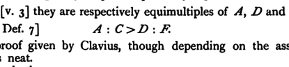

which makes Euclid's proof of V. 18 illegitimate, since it is nowhere proved in Book V. Hence any proof of the proposition now in question which involves this assumption even in the case where *B*, *P*, *Q* are all straight lines should not properly be given as an addition to Book V.; it should at least be postponed until we have learnt, by means of VI. 12, giving the actual construction of a fourth proportional, that such a fourth proportional exists.

Two proofs which are given of the proposition depend upon the following lemma.

*If A, B, C be three magnitudes of one kind, and D, E, F three magnitudes of one kind, then, if*
$$\begin{align*}
&\textit{the ratio of A to B is greater than that of D to E,} \\
\textit{and }&\textit{the ratio of B to C greater than that of E to F,} \\
\textit{ex aequali, }&\textit{the ratio of A to C is greater than that of D to F.}
\end{align*}$$

One proof of this does not depend upon the assumption referred to, and therefore, if this proof is used, the theorem can be added to Book V. The proof is that of Hauber (Camerer's Euclid, p. 358 of Vol. II.) and is reproduced by Mr H. M. Taylor. For brevity we will use symbols.

Take equimultiples $mA$, $mD$ of $A$, $D$ and $nB$, $nE$ of $B$, $E$ such that
$$mA > nB\text{, but } mD \ngtr nE\text{.}$$
Also let $pB$, $pE$ be equimultiples of $B$, $E$ and $qC$, $qF$ equimultiples of $C$, $F$ such that
$$pB > qC\text{, but } pE \ngtr qF\text{.}$$
Therefore, multiplying the first line by $p$ and the second by $n$, we have
$$\begin{align*}
&pmA > pnB\text{, } pmD \ngtr pnE\text{,} \\
\text{and }&npB > nqC\text{, } npE \ngtr nqF\text{,} \\
\text{whence }&pmA > nqC\text{, } pmD \ngtr nqF\text{.}
\end{align*}$$
Now $pmA$, $pmD$ are equimultiples of $mA$, $mD$,
and $nqC$, $nqF$ equimultiples of $qC$, $qF$.
Therefore [V. 3] they are respectively equimultiples of $A$, $D$ and of $C$, $F$.
Hence [V. Def. 7]
$$A : C > D : F\text{.}$$

Another proof given by Clavius, though depending on the assumption referred to, is neat.
Take $G$ such that
$$G : C = E : F\text{.}$$

$$\begin{align*}
\text{Therefore}\quad\quad\quad\quad B : C &> G : C\text{,} &\text{[V. 13]} \\
\text{and}\quad\quad\quad\quad B &> G\text{.} &\text{[V. 10]} \\
\text{Therefore}\quad\quad\quad\quad A : G &> A : B\text{.} &\text{[V. 8]}
\end{align*}$$
