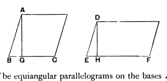

250 [BOOK VI [VI. 23

But, since
$$KD = CF,$$
$$CD : CE = CG : CK. \qquad \text{[VI. 14]}$$
Hence $CG : CK$ is a given ratio.
And $CB : CK$ was proved to be a given ratio.
Therefore the ratio of $CB$ to $CG$ is given. [*Data*, Prop. 8]

Lastly we may refer to Prop. 70 of the *Data*, the first part of which proves what corresponds exactly to VI. 23, namely that, *If in two equiangular parallelograms the sides containing the equal angles have a given ratio to one another* [i.e. one side in one to one side in the other], *the parallelograms themselves will also have a given ratio to one another*. [Here the ratios of $BC$ to $CG$ and of $CD$ to $CE$ are given.]

The construction is the same as in the last case, and we have $KD$ equal to $CF$, so that
$$CD : CE = CG : CK. \qquad \text{[VI. 14]}$$
But the ratio of $CD$ to $CE$ is given;
therefore the ratio of $CG$ to $CK$ is given.
And, by hypothesis, the ratio of $CG$ to $CB$ is given.
Therefore, by dividing the ratios [*Data*, Prop. 8], we see that the ratio of $CB$ to $CK$, and therefore [VI. 1] the ratio of $AC$ to $DK$, or of $AC$ to $CF$, is given.

Euclid extends these propositions to the case of two parallelograms which have *given* but not equal angles.

Pappus (VII. p. 928) exhibits the result of VI. 23 in a different way, which throws new light on compounded ratios. He proves, namely, that *a parallelogram is to an equiangular parallelogram as the rectangle contained by the adjacent sides of the first is to the rectangle contained by the adjacent sides of the second*.

Let $AC$, $DF$ be equiangular parallelograms on the bases $BC$, $EF$, and let the angles at $B$, $E$ be equal.

Draw perpendiculars $AG$, $DH$ to $BC$, $EF$ respectively.

Since the angles at $B$, $G$ are equal to those at $E$, $H$,
> the triangles $ABG$, $DEH$ are equiangular.

Therefore
$$BA : AG = ED : DH. \qquad \text{[VI. 4]}$$
But
$$BA : AG = (\text{rect. } BA, BC) : (\text{rect. } AG, BC),$$
and
$$ED : DH = (\text{rect. } ED, EF) : (\text{rect. } DH, EF). \qquad \text{[VI. 1]}$$
Therefore [V. 11 and V. 16]
$$(\text{rect. } AB, BC) : (\text{rect. } DE, EF) = (\text{rect. } AG, BC) : (\text{rect. } DH, EF)$$
$$= (AC) : (DF).$$

Thus it is proved that the ratio compounded of the ratios $AB : DE$ and $BC : EF$ is equal to the ratio of the rectangle $AB, BC$ to the rectangle $DE, EF$.
