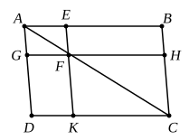

VI. 23, 24] PROPOSITIONS 23, 24 [251

Since each parallelogram in the figure of the proposition can be divided into pairs of equal triangles, and all the triangles which are the halves of either parallelogram have two sides respectively equal and the angles included by them equal or supplementary, it can be at once deduced from VI. 23 (or it can be independently proved by the same method) that *triangles which have one angle of the one equal or supplementary to one angle of the other are in the ratio compounded of the ratios of the sides about the equal or supplementary angles*. Cf. Pappus VII. pp. 894—6.

VI. 23 also shows that *rectangles, and therefore parallelograms or triangles, are to one another in the ratio compounded of the ratios of their bases and heights*.

The converse of VI. 23 is also true, as is easily proved by *reductio ad absurdum*. More generally, *if two parallelograms or triangles are in the ratio compounded of the ratios of two adjacent sides, the angles included by those sides are either equal or supplementary*.

---

### PROPOSITION 24.

*In any parallelogram the parallelograms about the diameter are similar both to the whole and to one another.*

Let $ABCD$ be a parallelogram, and $AC$ its diameter, and let $EG$, $HK$ be parallelograms about $AC$;
I say that each of the parallelograms $EG$, $HK$ is similar both to the whole $ABCD$ and to the other.

For, since $EF$ has been drawn parallel to $BC$, one of the sides of the triangle $ABC$,
> proportionally, as $BE$ is to $EA$, so is $CF$ to $FA$. [VI. 2]

Again, since $FG$ has been drawn parallel to $CD$, one of the sides of the triangle $ACD$,
> proportionally, as $CF$ is to $FA$, so is $DG$ to $GA$. [VI. 2]

But it was proved that,

as $CF$ is to $FA$, so also is $BE$ to $EA$;

therefore also, as $BE$ is to $EA$, so is $DG$ to $GA$,
and therefore, *componendo*,

as $BA$ is to $AE$, so is $DA$ to $AG$, [V. 18]

and, alternately,

as $BA$ is to $AD$, so is $EA$ to $AG$. [V. 16]

Therefore in the parallelograms $ABCD$, $EG$, the sides about the common angle $BAD$ are proportional.

And, since $GF$ is parallel to $DC$,
