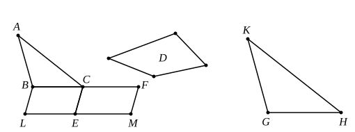

VI. 24, 25] PROPOSITIONS 24, 25 [253

that, when we have proved by VI. 2 the fact that the sides about the common angle are proportional, we can infer the proportionality of the other sides directly from I. 34 combined with V. 7. But it does not seem to me unnatural that Euclid should (1) deliberately refrain from making any use of I. 34 and (2) determine beforehand that he would prove the sides proportional *in a definite order* beginning with the sides $EA$, $AG$ and $BA$, $AD$ about the common angle and then taking the remaining sides in the order indicated by the order of the letters $A$, $G$, $F$, $E$. Given that Euclid started the proof with such a fixed intention in his mind, the course taken presents no difficulty, nor is the proof unsystematic or unduly drawn out. And its genuineness seems to me supported by the fact that the proof, when once the first two sides about the common angle have been disposed of, follows closely the order and method of VI. 18. Moreover, it could readily be adapted to the more general case of two polygons having a common angle and the other corresponding sides respectively parallel.

The parallelograms in the proposition are of course similarly situated as well as similar; and those "about the diameter" may be "about" the diameter *produced* as well as about the diameter itself.

From the first part of the proof it follows that parallelograms which have one angle equal to one angle and the sides about those angles proportional are similar.

Prop. 26 is the converse of Prop. 24, and there seems to be no reason why they should be separated as they are in the text by the interposition of VI. 25. Campanus has VI. 24 and 26 as VI. 22 and 23 respectively, VI. 23 as VI. 24, and VI. 25 as we have it.

---

### PROPOSITION 25.

*To construct one and the same figure similar to a given rectilineal figure and equal to another given rectilineal figure.*

Let $ABC$ be the given rectilineal figure to which the figure to be constructed must be similar, and $D$ that to which it must be equal;
thus it is required to construct one and the same figure similar to $ABC$ and equal to $D$.

Let there be applied to $BC$ the parallelogram $BE$ equal to the triangle $ABC$ [I. 44], and to $CE$ the parallelogram $CM$ equal to $D$ in the angle $FCE$ which is equal to the angle $CBL$. [I. 45]
