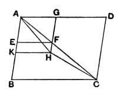

doubt due to the accident by which the figure was drawn as a triangle in the diagram.

The other observation is more important. After Euclid has proved that
$$\text{(fig. } ABC\text{) : (fig. } KGH\text{)} = (BE) : (EF),$$
he might have inferred *directly* from V. 14 that, since *ABC* is equal to *BE*, *KGH* is equal to *EF*. For V. 14 includes the proof of the fact that, if *A* is to *B* as *C* is to *D*, and *A* is equal to *C*, then *B* is equal to *D*, or that of four proportional magnitudes, if the first is equal to the third, the second is equal to the fourth. Instead of proceeding in this way, Euclid first permutes the proportion by V. 16 into
$$\text{(fig. } ABC\text{) : }(BE) = \text{(fig. } KGH\text{) : }(EF),$$
and then infers, as if the inference were easier in this form, that, since the *first* is equal to the *second*, the *third* is equal to the *fourth*. Yet there is no proposition to this effect in Euclid. The same unnecessary step of permutation is also found in the Greek text of XI. 23 and XII. 2, 5, 11, 12 and 18. In reproducing the proofs we may simply leave out the steps and refer to V. 14.

---

### PROPOSITION 26.

*If from a parallelogram there be taken away a parallelogram similar and similarly situated to the whole and having a common angle with it, it is about the same diameter with the whole.*

For from the parallelogram *ABCD* let there be taken away the parallelogram *AF* similar and similarly situated to *ABCD*, and having the angle *DAB* common with it;

I say that *ABCD* is about the same diameter with *AF*.

For suppose it is not, but, if possible, let *AHC* be the diameter <*of ABCD*>, let *GF* be produced and carried through to *H*, and let *HK* be drawn through *H* parallel to either of the straight lines *AD*, *BC*.
[I. 31]

Since, then, *ABCD* is about the same diameter with *KG*, therefore, as *DA* is to *AB*, so is *GA* to *AK*.
[VI. 24]

But also, because of the similarity of *ABCD*, *EG*, as *DA* is to *AB*, so is *GA* to *AE*; therefore also, as *GA* is to *AK*, so is *GA* to *AE*.
[V. 11]

Therefore *GA* has the same ratio to each of the straight lines *AK*, *AE*.
