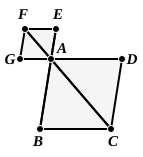

Therefore *AE* is equal to *AK* [V. 9], the less to the greater: which is impossible.

Therefore *ABCD* cannot but be about the same diameter with *AF*; therefore the parallelogram *ABCD* is about the same diameter with the parallelogram *AF*.

Therefore etc.

Q. E. D.

---

**"For suppose it is not, but, if possible, let *AHC* be the diameter."** What is meant is "For, if *AFC* is not the diameter of the parallelogram *AC*, let *AHC* be its diameter." The Greek text has ἔστω αὐτῶν διάμετρος ἡ ΑΘΓ; but clearly αὐτῶν is wrong, as we cannot assume that one straight line is the diameter of both parallelograms, which is just what we have to prove. F and V omit the αὐτῶν, and Heiberg prefers this correction to substituting αὐτοῦ after Peyrard. I have inserted "<of *ABCD*>" to make the meaning clear.

If the straight line *AHC* does not pass through *F*, it must meet either *GF* or *GF* produced in some point *H*. The reading in the text "and let *GF* be *produced and carried through to H*" (καὶ ἐκβληθεῖσα ἡ ΗΖ διήχθω ἐπὶ τὸ Θ) corresponds to the supposition that *H* is on *GF* produced. The words were left out by Theon, evidently because in the figure of the MSS. the letters E, Z and K, Θ were interchanged. Heiberg therefore, following August, has preferred to retain the words and to correct the figure, as well as the passage in the text where *AE*, *AK* were interchanged to be in accord with the MS. figure.

It is of course possible to prove the proposition directly, as is done by Dr Lachlan. Let *AF*, *AC* be the diagonals, and let us make no assumption as to how they fall.

Then, since *EF* is parallel to *AG* and therefore to *BC*, the angles *AEF*, *ABC* are equal.

And, since the parallelograms are similar,
$$AE : EF = AB : BC.\qquad\text{[VI. Def. 1]}$$

Hence the triangles *AEF*, *ABC* are similar,
[VI. 6]
and therefore the angle *FAE* is equal to the angle *CAB*.

Therefore *AF* falls on *AC*.

The proposition is equally true if the parallelogram which is similar and similarly situated to the given parallelogram is not "taken away" from it, but is so placed that it is entirely outside the other, while two sides form an angle vertically opposite to an angle of the other. In this case the diameters are not "the same," in the words of the enunciation, but are in a straight line with one another. This extension of the proposition is, as will be seen, necessary for obtaining, according to the method adopted by Euclid in his solution of the problem in VI. 28, the second solution of that problem.

