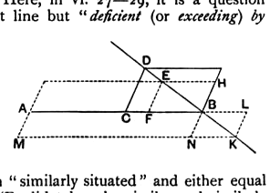

We have already (note on I. 44) seen the significance, in Greek geometry, of the theory of "the application of areas, their exceeding and their falling short." In I. 44 it was a question of "applying to a given straight line (exactly, without 'excess' or 'defect') a parallelogram equal to a given rectilinear figure, in a given angle." Here, in VI. 27—29, it is a question of parallelograms applied to a straight line but "*deficient (or exceeding) by parallelograms similar and similarly situated to a given parallelogram.*"

Apart from size, it is easy to construct any number of parallelograms "deficient" or "exceeding" in the manner described. Given the straight line *AB* to which the parallelogram has to be applied, we describe on the base *CB*, where *C* is on *AB*, or on *BA* produced beyond *A*, any parallelogram "similarly situated" and either equal or similar to the given parallelogram (Euclid takes the similar and similarly situated parallelogram on half the line), draw the diagonal *BD*, take on it (produced if necessary) any points as *E*, *K*, draw *EF*, or *KL*, parallel to *CD* to meet *AB* or *AB* produced and complete the parallelograms, as *AH*, *ML*.

If the point *E* is taken on *BD* or *BD* produced beyond *D*, it must be so taken that *EF* meets *AB* between *A* and *B*. Otherwise the parallelogram *AE* would not be applied to *AB* itself, as it is required to be.

The parallelograms *BD*, *BE*, being about the same diameter, are similar [VI. 24], and *BE* is the defect of the parallelogram *AE* relatively to *AB*. *AE* is then a parallelogram applied to *AB* but deficient by a parallelogram similar and similarly situated to *BD*.

If *K* is on *DB* produced, the parallelogram *BK* is similar to *BD*, but it is the *excess* of the parallelogram *AK* relatively to the base *AB*. *AK* is a parallelogram applied to *AB* but exceeding by a parallelogram similar and similarly situated to *BD*.

Thus it is seen that *BD* produced both ways is the *locus* of points, such as *E* or *K*, which determine, with the direction of *CD*, the position of *A*, and the direction of *AB*, parallelograms applied to *AB* and *deficient* or *exceeding* by parallelograms similar and similarly situated to the given parallelogram.

The importance of VI. 27—29 from a historical point of view cannot be overrated. They give the geometrical equivalent of the algebraical solution of the most general form of quadratic equation when that equation has a real and positive root. It will also enable us to find a real *negative* root of a quadratic equation; for such an equation can, by altering the sign of *x*, be turned into another with a real *positive* root, when the geometrical method again becomes applicable. It will also, as we shall see, enable us to represent *both* roots when both are real and positive, and therefore to represent both roots when both are real but either positive or negative.

The method of these propositions was constantly used by the Greek geometers in the solution of problems, and they constitute the foundation of Book X. of the *Elements* and of Apollonius' treatment of the conic sections. Simson's observation on the subject is entirely justified. He says namely on VI. 28, 29: "These two problems, to the first of which the 27th Prop. is necessary, are the most general and useful of all in the Elements, and are most frequently made use of by the ancient geometers in the solution of other problems; and therefore are very ignorantly left out by Tacquet and"
