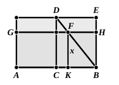

Dechales in their editions of the Elements, who pretend that they are scarce of any use."

It is strange that, with this observation before him, even Todhunter should have written as follows. "We have omitted in the sixth Book Propositions 27, 28, 29 and the first solution which Euclid gives of Proposition 30, as they appear now to be never required, and have been condemned as useless by various modern commentators; see Austin, Walker and Lardner."

VI. 27 contains the διορισμός, the condition for a real solution, of the problem contained in the proposition following it. The maximum of all the parallelograms having the given property which can be applied to a given straight line is that which is described upon half the line (τὸ ἀπὸ τῆς ἡμισείας ἀναγραφόμενον). This corresponds to the condition that an equation of the form
$$ax - px^2 = A$$
may have a real root. The correctness of the result may be seen by taking the case in which the parallelograms are rectangles, which enables us to leave out of account the sine of the angle of the parallelograms without any real loss of generality. Suppose the sides of the rectangle to which the defect is to be similar to be as $b$ to $c$, $b$ corresponding to the side of the defect which lies along $AB$. Suppose that ">$AKFG$ is any parallelogram applied to $AB$ having the given property, that $AB$ $= a$, and that $FK$ $= x$.

Then

$KB$ $= \frac{b}{c}x$, and therefore $AK$ $= a - \frac{b}{c}x$.

Hence $(a - \frac{b}{c}x)x = S$, where $S$ is the area of the rectangle ">$AKFG$.

Thus, given the equation
$$ax - \frac{b}{c}x^2 = S,$$
where $S$ is undetermined, VI. 27 tells us that, if $x$ is to have a real value, $S$ cannot be greater than the rectangle ">$CE$.

Now $CB$ $= \frac{a}{2}$, and therefore $CD$ $= \frac{c}{b}\cdot\frac{a}{2}$; whence
$$S \ngtr \frac{c}{b}\cdot\frac{a^2}{4},$$
which is just the same result as we obtain by the algebraical method.

In the particular case where *the defect of the parallelogram is to be a square*, the condition becomes the statement of the fact that, *if a straight line be divided into two parts, the rectangle contained by the parts cannot exceed the square on half the line*.

Now suppose that, instead of taking $F$ on $BD$ as in the figure of the proposition, we take $F$ on $BD$ produced beyond $D$ but so that $DF$ is less than $BD$.

Complete the figure, as shown, after the manner of the construction in the proposition.
