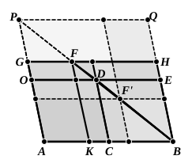

Then the parallelogram *FKBH* is similar to the given parallelogram to which the defect is to be similar. Hence the parallelogram *GAKF* is also a parallelogram applied to *AB* and satisfying the given condition.

We can now prove that *GAKF* is less than *CE* or *AD*.

Let *ED* produced meet *AG* in *O*.

Now, since *BF* is the diagonal of the parallelogram *KH*, the complements *KD*, *DH* are equal.

But
$$DH = DG\text{, and } DG\text{ is greater than } OF.$$

Therefore $KD > OF$.

Add *OK* to each; and
$$AD\text{, or } CE\text{, } > AF.$$

This other "case" of the proposition is found in all the mss., but Heiberg relegates it to the Appendix as being very obviously interpolated. The reasons for this course are that it is not in Euclid's manner to give a separate demonstration of such a "case"; it is rather his habit to give one case only and to leave the student to satisfy himself about any others (cf. I. 7). Internal evidence is also against the genuineness of the separate proof. It is put after the *conclusion* of the proposition instead of before it, and, if Euclid had intended to discuss two cases, he would have distinguished them at the beginning of the proposition, as it was his invariable practice to do. Moreover the second "case" is the less worth giving because it can be so easily reduced to the first. For suppose *F'* to be taken on *BD* so that *FD* = *F'D*. Produce *BF* to meet *AG* produced in *P*. Complete the parallelogram *BAPQ*, and draw through *F'* straight lines parallel to and meeting its opposite sides.

Then the complement *F'Q* is equal to the complement *AF'*.

And it is at once seen that *AF*, *F'Q* are equal and similar. Hence the solution of the problem represented by *AF* or *F'Q* gives a parallelogram of the same size as *AF'* arrived at as in the first "case."

It is worth noting that the actual difference between the parallelogram *AF* and the maximum area *AD* that it can possibly have is represented in the figure. The difference is the small parallelogram *DF*.

---

### PROPOSITION 28.

To a given straight line to apply a parallelogram equal to 
a given rectilineal figure and deficient by a parallelogrammic 
figure similar to a given one : thus the given rectilineal figure 
must not be greater than the parallelogram described on the 
half of the straight line and similar to the defect.

Let *AB* be the given straight line, *C* the given rectilineal 
figure to which the figure to be applied to *AB* is required to 
be equal, not being greater than the parallelogram described 
on the half of *AB* and similar to the defect, and *D* the 
parallelogram to which the defect is required to be similar;
