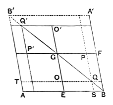
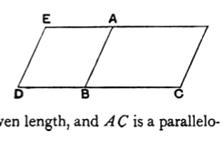

Similarly
$$\frac{a}{2} = EB = GE \cdot \frac{b}{c},$$
so that
$$GE = \frac{c}{b} \cdot \frac{a}{2}.$$

Therefore the parallelogram $GQ = GO^2 \cdot \frac{b}{c},$
and the parallelogram $GB = \frac{c}{b} \cdot \frac{a^2}{4}.$

Thus, in taking the parallelogram *GQ* equal to $(GB - S)$, Euclid really finds *GO* from the equation
$$GO^2 \cdot \frac{b}{c} = \frac{c}{b} \cdot \frac{a^2}{4} - S.$$

The value which he finds is
$$GO = \sqrt{\frac{c}{b} \left(\frac{c}{b} \cdot \frac{a^2}{4} - S\right)},$$
and he finds *QS* (or $x$) by subtracting *GO* from *GE*; whence
$$x = \frac{c}{b} \cdot \frac{a}{2} - \sqrt{\frac{c}{b} \left(\frac{c}{b} \cdot \frac{a^2}{4} - S\right)}.$$

It will be observed that Euclid only gives one solution, that corresponding to the *negative* sign before the radical. But the reason must be the same as that for which he only gives one "case" in VI. 27. He cannot have failed to see how to *add* *GO* to *GE* would give another solution. As shown under the last proposition, the other solution can be arrived at

(1) by placing the parallelogram *GOQP* in the angle vertically opposite to *FGE* so that *GQ'* lies along *BG* produced. The parallelogram *AQ'* then gives the second solution. The side of this parallelogram lying along *AB* is equal to *SB*. The other side is what we have called $x$, and in this case
$$\begin{aligned}
x &= EG + GO \\
&= \frac{c}{b} \cdot \frac{a}{2} + \sqrt{\frac{c}{b} \left(\frac{c}{b} \cdot \frac{a^2}{4} - S\right)}.
\end{aligned}$$

(2) A parallelogram similar and equal to *AQ'* can also be obtained by producing *BG* till it meets *AT* produced and completing the parallelogram *B'ABA'*, whence it is seen that the complement *QA'* is equal to the complement *AQ*, besides being equal and similar and similarly situated to *AQ'*.

A particular case of this proposition, indicated in Prop. 85 of the *Data*, is that in which the sides of the defect are equal, so that the defect is a *rhombus* with a given angle. Prop. 85 proves that, *If two straight lines contain a given area in a given angle, and the sum of the straight lines be given, each of them will be given also.* *AB*, *BC* being the given straight lines "containing a given area *AC* in a given angle *ABC*," one side *CB* is produced to *D* so that *BD* is equal to *AB*, and the parallelograms are completed. Then, by hypothesis, *CD* is of given length, and *AC* is a parallelo-

