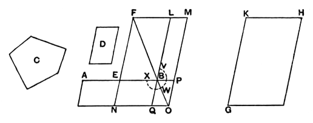

gram applied to *CD* falling short by a rhombus (*AD*) with a given angle *EDB*. The case is thus a particular case of Prop. 58 of the *Data* quoted above (p. 263) as corresponding to VI. 28.

A particular case of the last, that namely in which the defect is a *square*, corresponding to the equation
$$ax - x^2 = b^2,$$
is important. This is the problem of *applying to a given straight line a rectangle equal to a given area and falling short by a square*; and it can be solved, without the aid of Book VI., as shown above under II. 5 (Vol. I. pp. 383–4).

---

### PROPOSITION 29.

*To a given straight line to apply a parallelogram equal to a given rectilineal figure and exceeding by a parallelogrammic figure similar to a given one.*

Let *AB* be the given straight line, *C* the given rectilineal figure to which the figure to be applied to *AB* is required to be equal, and *D* that to which the excess is required to be similar;
thus it is required to apply to the straight line *AB* a parallelogram equal to the rectilineal figure *C* and exceeding by a parallelogrammic figure similar to *D*.

Let *AB* be bisected at *E*;
let there be described on *EB* the parallelogram *BF* similar and similarly situated to *D*;
and let *GH* be constructed at once equal to the sum of *BF*, *C* and similar and similarly situated to *D*. [VI. 25]
Let *KH* correspond to *FL* and *KG* to *FE*.
Now, since *GH* is greater than *FB*,
therefore *KH* is also greater than *FL*, and *KG* than *FE*.
