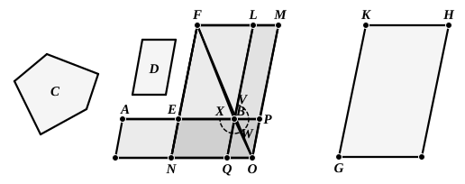

gram applied to $CD$ falling short by a rhombus (">$AD$) with a given angle $EDB$. The case is thus a particular case of Prop. 58 of the *Data* quoted above (p. 263) as corresponding to VI. 28.

A particular case of the last, that namely in which the defect is a *square*, corresponding to the equation
$$ax - x^2 = b^2,$$
is important. This is the problem of *applying to a given straight line a rectangle equal to a given area and falling short by a square*; and it can be solved, without the aid of Book VI., as shown above under II. 5 (Vol. I. pp. 383–4).

---

### PROPOSITION 29.

*To a given straight line to apply a parallelogram equal to a given rectilineal figure and exceeding by a parallelogrammic figure similar to a given one.*

Let $AB$ be the given straight line, ">$C$ the given rectilineal figure to which the figure to be applied to $AB$ is required to be equal, and ">$D$ that to which the excess is required to be similar;
thus it is required to apply to the straight line $AB$ a parallelogram equal to the rectilineal figure ">$C$ and exceeding by a parallelogrammic figure similar to ">$D$.

Let $AB$ be bisected at $E$;
let there be described on $EB$ the parallelogram ">$BF$ similar and similarly situated to ">$D$;
and let ">$GH$ be constructed at once equal to the sum of ">$BF$, ">$C$ and similar and similarly situated to ">$D$. [VI. 25]
Let $KH$ correspond to $FL$ and $KG$ to $FE$.
Now, since ">$GH$ is greater than ">$FB$,
therefore $KH$ is also greater than $FL$, and $KG$ than $FE$.
