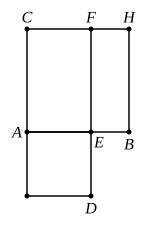

His determination of the similar parallelogram ">$MN$ equal to the sum of ">$EL$ 
and $S$ corresponds to proving that
$$FN^2 \cdot \frac{b}{c} = \frac{c}{b} \cdot \frac{a^2}{4} + S,$$
or
$$FN = \sqrt{\frac{c}{b} \left(\frac{c}{b} \cdot \frac{a^2}{4} + S\right)},$$
whence $x$ is found as
$$x = FN - FE = \sqrt{\frac{c}{b} \left(\frac{c}{b} \cdot \frac{a^2}{4} + S\right)} - \frac{c}{b} \cdot \frac{a}{2}.$$

Euclid takes, in this case, the solution corresponding to the *positive* sign 
before the radical because, from his point of view, that would be the *only* 
solution.

No διορισμός is necessary because a real geometrical solution is always 
possible whatever be the size of $S$.

Again the $Data$ has a proposition indicating the particular case in which 
the excess is a rhombus with a given angle. Prop. 84 proves that, *If two* 
*straight lines contain a given area in a given angle, and one of the straight lines* 
*is greater than the other by a given straight line, each of the two straight lines is* 
*given also.* The proof reduces the proposition to a particular case of $Data$, 
Prop. 59, quoted above as corresponding to VI. 29.

Again there is an important particular case which can be solved by means 
of Book II. only, as shown under II. 6 above (Vol. I. pp. 386—8), the case namely 
in which the excess is a *square*, corresponding to the solution of the equation
$$ax + x^2 = b^2.$$
*This is the problem of applying to a given straight line a rectangle equal to a* 
*given area and exceeding by a square.*

---

### PROPOSITION 30.

To cut a given finite straight line in extreme and mean 
ratio.

Let $AB$ be the given finite straight line ; 
thus it is required to cut $AB$ in extreme and mean ratio.

On $AB$ let the square ">$BC$ be described ; 
and let there be applied to $AC$ the parallelo- 
gram ">$CD$ equal to ">$BC$ and exceeding by 
the figure ">$AD$ similar to ">$BC$. [VI. 29]

Now ">$BC$ is a square ;

therefore ">$AD$ is also a square.

And, since ">$BC$ is equal to ">$CD$, 
let ">$CE$ be subtracted from each ;

therefore the remainder ">$BF$ is equal to 
the remainder ">$AD$.

