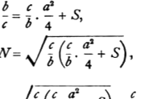

His determination of the similar parallelogram *MN* equal to the sum of *EL* and *S* corresponds to proving that
$$FN^2 \cdot \frac{b}{c} = \frac{c}{b} \cdot \frac{a^2}{4} + S,$$
or
$$FN = \sqrt{\frac{c}{b} \left(\frac{c}{b} \cdot \frac{a^2}{4} + S\right)},$$
whence $x$ is found as
$$x = FN - FE = \sqrt{\frac{c}{b} \left(\frac{c}{b} \cdot \frac{a^2}{4} + S\right)} - \frac{c}{b} \cdot \frac{a}{2}.$$

Euclid takes, in this case, the solution corresponding to the *positive* sign before the radical because, from his point of view, that would be the *only* solution.

No διορισμός is necessary because a real geometrical solution is always possible whatever be the size of $S$.

Again the *Data* has a proposition indicating the particular case in which the excess is a rhombus with a given angle. Prop. 84 proves that, *If two straight lines contain a given area in a given angle, and one of the straight lines is greater than the other by a given straight line, each of the two straight lines is given also.* The proof reduces the proposition to a particular case of *Data*, Prop. 59, quoted above as corresponding to VI. 29.

Again there is an important particular case which can be solved by means of Book II. only, as shown under II. 6 above (Vol. I. pp. 386–8), the case namely in which the excess is a *square*, corresponding to the solution of the equation
$$ax + x^2 = b^2.$$
*This is the problem of applying to a given straight line a rectangle equal to a given area and exceeding by a square.*

---

### PROPOSITION 30.

*To cut a given finite straight line in extreme and mean ratio.*

Let *AB* be the given finite straight line;
thus it is required to cut *AB* in extreme and mean ratio.

On *AB* let the square *BC* be described;
and let there be applied to *AC* the parallelogram *CD* equal to *BC* and exceeding by the figure *AD* similar to *BC*. [VI. 29]

Now *BC* is a square;
therefore *AD* is also a square.
And, since *BC* is equal to *CD*,
let *CE* be subtracted from each;
therefore the remainder *BF* is equal to the remainder *AD*.

