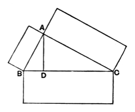

been drawn from the right angle at $A$ perpendicular to the base $BC$,
the triangles $ABD$, $ADC$ adjoining the perpendicular are similar both to the whole $ABC$ and to one another. [vi. 8]

And, since $ABC$ is similar to $ABD$,
therefore, as $CB$ is to $BA$, so is $AB$ to $BD$. [vi. Def. 1]

And, since three straight lines are proportional,
as the first is to the third, so is the figure on the first to the similar and similarly described figure on the second. [vi. 19, Por.]

Therefore, as $CB$ is to $BD$, so is the figure on $CB$ to the similar and similarly described figure on $BA$.

For the same reason also,
as $BC$ is to $CD$, so is the figure on $BC$ to that on $CA$;
so that, in addition,
as $BC$ is to $BD, DC$, so is the figure on $BC$ to the similar and similarly described figures on $BA, AC$.

But $BC$ is equal to $BD, DC$;
therefore the figure on $BC$ is also equal to the similar and similarly described figures on $BA, AC$.

Therefore etc.

$$\text{Q. E. D.}$$

---

As we have seen (note on I. 47), this extension of I. 47 is credited by Proclus to Euclid personally.

There is one inference in the proof which requires examination. Euclid proves that
$$CB : BD = (\text{figure on } CB) : (\text{figure on } BA),$$
and that
$$BC : CD = (\text{figure on } BC) : (\text{figure on } CA),$$
and then infers directly that
$$BC : (BD + CD) = (\text{fig. on } BC) : (\text{sum of figs. on } BA \text{ and } AC).$$
Apparently v. 24 must be relied on as justifying this inference. But it is not directly applicable; for what it proves is that, if
$$a : b = c : d,$$
and
$$e : b = f : d,$$
then
$$(a + e) : b = (c + f) : d.$$
Thus we should *invert* the first two proportions given above (by Simson's
