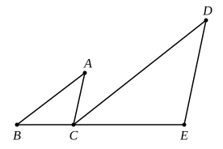

For, since $AB$ is parallel to $DC$,
and the straight line $AC$ has fallen upon them,
the alternate angles $BAC$, $ACD$ are equal to one another. [I. 29]

For the same reason
the angle $CDE$ is also equal to the angle $ACD$;
so that the angle $BAC$ is equal to the angle $CDE$.

And, since $ABC$, $DCE$ are two triangles having one angle, the angle at $A$, equal to one angle, the angle at $D$,
and the sides about the equal angles proportional,
so that, as $BA$ is to $AC$, so is $CD$ to $DE$,
therefore the triangle $ABC$ is equiangular with the triangle $DCE$; [vi. 6]
therefore the angle $ABC$ is equal to the angle $DCE$.

But the angle $ACD$ was also proved equal to the angle $BAC$;
therefore the whole angle $ACE$ is equal to the two angles $ABC$, $BAC$.

Let the angle $ACB$ be added to each;
therefore the angles $ACE$, $ACB$ are equal to the angles $BAC$, $ACB$, $CBA$.

But the angles $BAC$, $ABC$, $ACB$ are equal to two right angles; [I. 32]
therefore the angles $ACE$, $ACB$ are also equal to two right angles.

Therefore with a straight line $AC$, and at the point $C$ on it, the two straight lines $BC$, $CE$ not lying on the same side make the adjacent angles $ACE$, $ACB$ equal to two right angles;
therefore $BC$ is in a straight line with $CE$. [I. 14]

Therefore etc.

$$\text{Q. E. D.}$$

---

It has often been pointed out (e.g. by Clavius, Lardner and Todhunter) that the enunciation of this proposition is not precise enough. Suppose that
